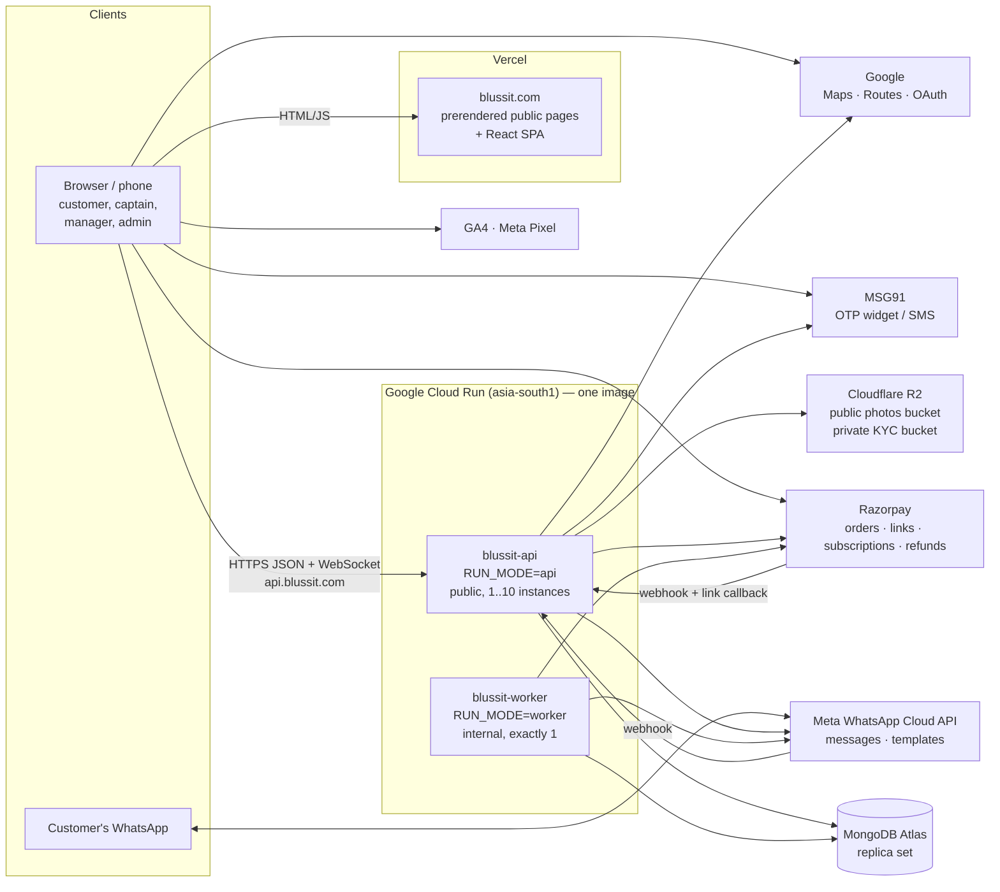

# BLUSSIT — System Architecture

The one document that explains the whole system — what it does, how it is
built, where everything runs, how the data is shaped and how the main flows
work — so a new developer can understand the complete project from here.

**Status:** written 2026-10-07 (branch `blussit-v2`). The 2026-10-07 round
(customer wallet, booking edits, on-site add-ons, custom multi-car plans, new
WhatsApp templates, manager WhatsApp toggle) has landed in the backend; its
screens are being built. Anything still unfinished is marked **in progress**. See "Keeping this
document current" at the end — the founder's standing rule is that every
change updates this file.

Related documents (more depth on one topic each):
[DEPLOYMENT.md](../DEPLOYMENT.md) (operator runbook) ·
[docs/FEATURE_PLAN_WALLET_EDITS_PLANS_2026-10-07.md](FEATURE_PLAN_WALLET_EDITS_PLANS_2026-10-07.md) (current build spec) ·
[docs/SOCIETY_PLANS.md](SOCIETY_PLANS.md) (society plans in detail) ·
[docs/CONTACT_CARD_ARCHITECTURE.md](CONTACT_CARD_ARCHITECTURE.md) (Blussit Contact Card — design, not built) ·
[docs/SEO_AUDIT_2026-10-06.md](SEO_AUDIT_2026-10-06.md), [docs/SEO_KEYWORDS.md](SEO_KEYWORDS.md) (SEO) ·
[docs/PRE_PRODUCTION_AUDIT_2026-10-07.md](PRE_PRODUCTION_AUDIT_2026-10-07.md) and
[docs/PRODUCTION_REMEDIATION_REPORT_2026-10-07.md](PRODUCTION_REMEDIATION_REPORT_2026-10-07.md) (audit + fixes, IDs like PAY-02 used in code comments) ·
[docs/SECURITY_REPO_CLEANUP.md](SECURITY_REPO_CLEANUP.md) ·
`backend/tests/README.md`. `CONTEXT.md` at the repo root is an older
(2026-08) hand-off note; where it disagrees with this file, this file wins.

Contents: 1 What BLUSSIT is · 2 Big picture · 3 Repository layout ·
4 Backend (request path, RUN_MODE, health, background jobs, configuration) ·
5 Roles and auth · 6 Data model · 7 Core flows · 8 Frontend · 9 External
services · 10 Deployment · 11 Scalability · 12 Observability · 13 Security ·
14 Testing · 15 Limitations and roadmap · 16 Keeping this document current

---

## 1. What BLUSSIT is

A **doorstep car (and bike) wash** business in **Indore** (blussit.com).

- **Customers** book a wash at their address (website, customer app at
  `/app`, or WhatsApp chat), pick a date and a 3-hour slot, pay online
  (Razorpay) or in cash/QR at the door, and track the job live. They can buy
  **monthly passes** (a number of washes for one car or car type, optionally
  on auto-pay), and residents of housing **societies** buy per-car society
  plans (a daily bucket wash + premium washes).
- **Captains** (field washers) get assigned jobs, travel, prove arrival with
  the customer's 4-digit code and GPS, take before/after photos, and collect
  cash or a QR payment when due. They earn per job into a **captain wallet**.
- **Managers** run one **service center**: the booking queue, assigning
  captains, captain KYC and attendance, complaints, selling plans, societies,
  late-cancellation charges, inventory, the center's KPIs.
- **Admins** run the platform: catalogue and prices, plans, coupons,
  centers/zones/capacity, booking policy, users and staff, WhatsApp
  (templates, CRM inbox), reports and audit logs.

All money is in Indian rupees; all business time is **IST** (people-facing
times are 12-hour, e.g. "9:00 AM – 12:00 PM"; slot keys stay 24-hour
`"09:00-12:00"`). Opening hours are 7 AM – 7 PM.

---

## 2. The big picture



ASCII version:

```
 browser/phone ──HTML──> Vercel (blussit.com: prerendered public pages + SPA)
      │
      ├──HTTPS + WSS──> api.blussit.com = Cloud Run "blussit-api" (RUN_MODE=api, 1..N)
      │                     │  routes, webhooks, websockets (+ relay via ws_events)
      │                     ▼
      │               MongoDB Atlas (replica set: transactions + change streams)
      │                     ▲
      │                     │  sweeps, retries, template sync, index builds, migrations
      │               Cloud Run "blussit-worker" (RUN_MODE=worker, exactly 1, internal)
      │
      ├──> Razorpay checkout modal, MSG91 OTP widget, Google Maps/OAuth, GA4, Meta Pixel
 WhatsApp <──> Meta Cloud API ──webhook──> blussit-api
 Razorpay ──webhook / payment-link callback──> blussit-api
 blussit-api ──> Razorpay, Meta, MSG91, Google Routes, R2 (photos, KYC docs)
 blussit-worker ──> Razorpay (reconciliation), Meta (sends, retries, template sync)
```

Key properties:

- **Stateless API.** Logins are JWTs; nothing about a user lives in an API
  instance's memory. Websocket fan-out across instances goes through the
  `ws_events` collection (each instance tails it with a change stream).
- **Database as the source of truth for everything time-based.** Sweeps
  work from database state, so a restarted or replaced worker simply picks up
  where things are.
- **No Redis, no queue broker.** Background work is asyncio loops in the
  worker; single-flight is a Mongo lease; the WhatsApp queue is a Mongo
  collection with leases and backoff.
- **Fail closed on money and capacity.** Unique indexes + guarded atomic
  updates + transactions; readiness refuses traffic while a critical unique
  index is missing.

---

## 3. Repository layout

```
backend/                      FastAPI service (Python 3.12, Motor/MongoDB)
  Dockerfile                  the ONE image (uvicorn app.main:app); RUN_MODE picks the role
  requirements-runtime.txt    pinned runtime deps (requirements.txt adds dev/test)
  .gcloudignore/.dockerignore keep env files, venvs, tests out of uploads/images
  app/
    main.py                   app wiring: middleware, routers, RUN_MODE, background loops,
                              lease, health/readiness, start-up/shut-down
    core/                     config (settings + production validator), database (client,
                              indexes, critical-index check), security (JWT, hashing),
                              dependencies + authz (role guards, center scoping),
                              rate_limit, storage (local/R2), ws_manager (websocket relay),
                              http_client (pooled outbound HTTP), logging_setup (JSON logs,
                              masking, request ids), exceptions, responses
    routes/v1/                HTTP layer, one router per domain, all under /api/v1
    controllers/              thin glue for some domains (response shaping, audit)
    services/                 business rules (booking_service.py is the heart, ~8.7k lines)
    repositories/             data access (BaseRepository subclasses, index builders)
    models/                   Pydantic document shapes + enums.py
    schemas/                  request/response DTOs
    utils/                    timezone (IST), slots, money rounding, phone + plate
                              normalisation, geo, serializers
    scripts/                  one-off backfills/migrations, seed_dev, smoke test
    seed.py                   reference data + (local only) demo accounts; passwords from SEED_*_PASSWORD / git-ignored backend/.seed-credentials.local / generated (mode 600), none hardcoded
  tests/                      pytest suite (~160 files) on a local replica-set Mongo
frontend/                     React 19 + TypeScript + Vite SPA (Vercel)
  src/App.tsx                 every route, grouped by role
  src/pages/{public,auth,customer,captain,manager,admin,society,shared}/
  src/components/             ui/ (design system), booking/, customer/, captain/, manager/,
                              admin/, public/, shared/, society/, layout/
  src/api/                    one module per backend domain, all via lib/api-client.ts
  src/lib/                    api-client (axios, token refresh), socket, razorpay,
                              googleMaps, otpWidget, metaPixel, date/price helpers
  src/context/                AuthContext, Toast, Confirm, captain i18n (en/hi)
  src/routes/                 ProtectedRoute / GuestOnlyRoute, prefetch
  src/seo/pages.json          titles/descriptions/canonicals + sitemap source
  src/prerender/entry.tsx     SSR entry used at build time
  scripts/prerender.mjs       build-time prerender of the public pages
  vercel.json                 rewrites, security headers, CSP (report-only), caching
scripts/
  deploy-gcp.sh               build one image, deploy blussit-worker then blussit-api
  dev.sh                      local stack: Mongo (docker, :27099) + backend + website
docs/                         this file and the topic documents listed above
DEPLOYMENT.md                 operator runbook
```

**Adding a backend feature** follows the layers: model → schema →
repository → service → (controller) → route → mount the router in
`include_business_routers()` in `backend/app/main.py` → frontend type in
`src/types/index.ts` → `src/api/<domain>.ts` → page/component → route in
`App.tsx` → nav item in the area's layout. New collections get their indexes
in `create_indexes()` (and in `_CRITICAL_INDEXES` if a business rule depends
on a unique index).

---

## 4. Backend

### 4.1 Request path

```
uvicorn → RequestIdMiddleware (X-Request-ID, log context)
        → WorkerRouteGuard (RUN_MODE=worker: 404 except /api/health, /api/ready)
        → GZip → CORS → LimitRequestBody (413; 2 MB JSON, upload caps)
        → CatchUnhandledErrors (JSON 500 inside CORS)
        → security headers (nosniff, DENY framing, noindex, HSTS, uploads CSP,
          short public cache on anonymous catalogue GETs)
        → rate limit (per IP, per instance)
        → router → dependency guards (auth, role, center scope) → controller/service
```

Every response is JSON `{success, data | error_code, message, details}`.
Domain errors are `AppException` subclasses (400/401/403/404/409); a unique
index refusing a write becomes 409 `CONFLICT`; validation errors are 422.
API docs (`/api/docs`) exist only with `DEBUG=true` (never in production).

### 4.2 RUN_MODE — one image, two services

| | `api` | `worker` | `all` (default) |
|---|---|---|---|
| Business routers, webhooks, websockets, `/uploads` | yes | **no** (not mounted; guard 404s) | yes |
| `/api/health`, `/api/ready` | yes | yes | yes |
| Reminder/sweep loop (lease) | no | yes | yes |
| WhatsApp retry loop, template sync loop | no | yes | yes |
| Index creation, boot backfills/migrations, boot template sync | no | yes | yes |
| Websocket relay (`ws_events` change stream) | yes (delivers) | yes (publishes worker events) | yes |

Production must set `RUN_MODE` explicitly (the validator refuses the
default). Code: `_run_mode()`, `_runs_background_jobs()`,
`_serves_public_routes()`, `WorkerRouteGuard`, `include_business_routers()`,
`on_startup()` in `backend/app/main.py`.

**Boot order.** The worker builds indexes in the background after it starts
answering probes (`_deferred_init`: indexes → employee ids → launch offer →
`last_completed_at` → seat ownership → booking money fields → open
late-cancel charges moved to the customer wallet → booking address
snapshots → template sync; the last three come from the 2026-10-07 round
and are looked up by name in `_OPTIONAL_BOOT_TASKS` — idempotent, skipped
if absent, a failure is logged and retried next boot). The API never
builds indexes; its `/api/ready` only checks that the critical unique indexes
exist. So on a brand-new database the API is not ready until the worker's
first build finishes, and every deploy rolls out the worker first.

**Shutdown.** SIGTERM → uvicorn stops taking requests (4 s) → `on_shutdown`
sets the stop event; loops end at their next checkpoint (never mid-send),
start-up work and background WhatsApp sends get the rest of a 5 s grace, then
the HTTP clients and the database are closed. The lease is released so
another worker can take over at once.

### 4.3 Health and readiness

- `GET /api/health` — liveness. No dependency is touched. 503 `LOOP_DEAD` only
  if a background loop this process started has ended while not shutting
  down (the worker's liveness probe then restarts it). Reports `mode`.
- `GET /api/ready` — readiness. 200 only when Mongo answers a ping within 2 s
  and every index in `_CRITICAL_INDEXES` exists (cached 60 s after success);
  otherwise 503 `NOT_READY` with `checks` (and `missing_indexes`). Used by both
  services' startup probes and the deploy script.

### 4.4 Background jobs (worker)

The **reminder loop** (`_reminder_loop` → `_sweep_once`) runs every 60 s on
the instance holding the lease `locks._id="reminder_loop"` (90 s, renewed
between sweeps and every 10 s inside long ones; a lost renewal stops the pass
at once). Each pass has a 70 s budget; each sweep 15 s of its own and a hard
60 s timeout (below the lease); one failing sweep is logged and skipped.
Paced sweeps stamp their last run on the lease document (`*_at` fields), so a
fresh worker doesn't re-run them. In order:

| Sweep | What | Cadence |
|---|---|---|
| slot holds | release expired seat holds (`_sweep_holds`) | every pass |
| pending orders | ask Razorpay about checkouts whose browser never verified; settle via the shared claim | every pass |
| unpaid expiry | cancel "pay online" bookings past `payment_window_minutes` (only if still unpaid, PAY-02) after asking Razorpay | every pass |
| payment reminders | one nudge before the window closes (+ WhatsApp buttons) | every pass |
| payment links | settle paid Razorpay payment links | every pass |
| autopay renewals / pending mandates | refresh auto-pay passes from Razorpay | every pass |
| captain start reminders | ping the captain ~30 min before the slot | every pass |
| **customer pre-slot reminders** | `booking_reminder` WhatsApp ~2 h before the slot, 7 AM–7 PM, claim-first (BOOKING, 2026-10-07) | every pass |
| unassigned nudges | manager: booking still has no captain (first WhatsApp, repeats in-app) | every pass |
| late to start / not reached / stuck on the way / overrun / idle after arrival / left site | flag the booking + notify (anti-moonlighting checks) | every pass |
| pass expiring / pass expired | notices + flip to expired (10 AM–7 PM only) | every pass |
| society attendance alerts, society schedule | missed daily wash alert; materialise premium-wash visits | every pass |
| recycle-bin purge | hard-delete bookings soft-deleted > 30 days (refused rows parked) | every pass |
| seat counter check | `reconcile_slot_counters(repair=False)`; drift logged as ERROR | daily |
| **review requests** | `NotificationService.send_review_requests()` — Google review ask ~2 h after a completed + fully paid visit, 10 AM–7 PM, only when the admin set `google_review_url` and the `review_request_google` template is approved; atomic claims (NOTIFY, 2026-10-07 — **in progress** until the template is approved) | every 10 min |
| pass wash reminder | "N washes left" (marketing template, opt-out respected) | hourly |
| repeat-booking nudge | "time for a wash?" to lapsed customers | hourly |

Other worker loops (lease-free; the work claims its own rows):

- **WhatsApp retry** (`_whatsapp_retry_loop`): every 30 s, drains
  `whatsapp_queue` in slices (≤ 20 rows / 4 s each, ≤ 100 rows / 25 s per
  pass); backoff 60 s → 30 min; dead-lettered after 7 attempts or 3 h.
- **Template sync** (`_template_sync_loop`): every 5 min asks for a sync;
  `sync_templates_if_due` runs it at most hourly across instances.
- **Websocket relay**: publishes the worker's events to `ws_events`.

### 4.5 Configuration

All settings are in `backend/app/core/config.py` (`Settings`, read from real
environment variables, else an env file: `ENV_FILE`, else
`backend/.env.development`, else `backend/.env` — never `.env.production`).
`validate_settings()` is the one rule list: the app refuses to start on any
problem (all listed at once) and `scripts/deploy-gcp.sh` runs the same check
on the exact values it ships (`python -m app.core.config --check
--require-production`). Names only below — see DEPLOYMENT.md for which are
secrets.

| Group | Settings | Production rule |
|---|---|---|
| App | `APP_NAME`, `APP_ENV` (development/test/staging/production), `RUN_MODE` (api/worker/all), `API_V1_PREFIX`, `DEBUG`, `LOG_FORMAT`, `SENTRY_DSN`, `SENTRY_TRACES_SAMPLE_RATE` | `APP_ENV=production`, `RUN_MODE` explicit, `DEBUG=false` |
| HTTP edge | `CORS_ORIGINS`, `PUBLIC_BASE_URL`, `RATE_LIMIT_ENABLED`, `TRUST_PROXY_HEADERS`, `TRUSTED_PROXY_COUNT` | https site origins only; `https://api.blussit.com`; limits on; trust proxy (Cloud Run) |
| Database | `MONGO_URI`, `MONGO_DB_NAME` | remote cluster (never localhost) |
| Auth | `JWT_SECRET_KEY`, `JWT_ALGORITHM`, `ACCESS_TOKEN_EXPIRE_MINUTES` (15), `REFRESH_TOKEN_EXPIRE_DAYS` (7) | secret ≥ 32 chars, not the default |
| Storage | `STORAGE_PROVIDER` (local/r2), `UPLOAD_DIR`, `R2_ENDPOINT_URL`, `R2_ACCESS_KEY_ID`, `R2_SECRET_ACCESS_KEY`, `R2_BUCKET_NAME`, `R2_PRIVATE_BUCKET_NAME`, `R2_PUBLIC_BASE_URL`, `R2_UPLOAD_PREFIX` | r2 with both buckets; public URL is r2.dev/custom domain |
| WhatsApp | `WHATSAPP_PROVIDER` (log/meta_cloud), `WHATSAPP_ACCESS_TOKEN`, `WHATSAPP_PHONE_NUMBER_ID`, `WHATSAPP_BUSINESS_ACCOUNT_ID`, `WHATSAPP_BUSINESS_NUMBER`, `WHATSAPP_API_VERSION`, `WHATSAPP_OTP_TEMPLATE_NAME`/`_LANGUAGE`, `WHATSAPP_UPDATE_TEMPLATE_NAME`, `WHATSAPP_TEMP_PASSWORD_TEMPLATE_NAME`, `WHATSAPP_TEMPLATE_LANGUAGE`, `WHATSAPP_WEBHOOK_VERIFY_TOKEN`, `WHATSAPP_APP_SECRET` | meta_cloud; all credentials, templates and the business number required |
| SMS / OTP | `SMS_PROVIDER` (""/log/msg91), `MSG91_AUTH_KEY`, `MSG91_OTP_TEMPLATE_ID`, `MSG91_WIDGET_ID`, `MSG91_TOKEN_AUTH`, `OTP_CHANNEL` (whatsapp/sms) | an SMS fallback (msg91 or the widget trio); never `log` |
| Payments | `RAZORPAY_KEY_ID`, `RAZORPAY_KEY_SECRET`, `RAZORPAY_WEBHOOK_SECRET`, `RAZORPAY_LIVE_KEY_ID`/`_SECRET` (parking only) | `rzp_live_` key + secret + webhook secret |
| Google | `GOOGLE_MAPS_BROWSER_KEY`, `GOOGLE_MAPS_SERVER_KEY`, `GOOGLE_OAUTH_CLIENT_ID` | optional |
| Other | `META_PIXEL_ID`, `DEFAULT_PAGE_SIZE`, `MAX_PAGE_SIZE`, `DEV_TOOLS_ENABLED`, `DEV_OTP_CODE` | dev tools refused in production |
| Coupon bundles | `COUPON_BUNDLE_MAX_BYTES` (2 MB), `COUPON_BUNDLE_MAX_ROWS` (100,000), `COUPON_BUNDLE_BATCH_SIZE` (5,000), `COUPON_MISS_LIMIT` (10 per user/device per window; 0 = off), `COUPON_MISS_IP_LIMIT` (40 per IP), `COUPON_MISS_WINDOW_SECONDS` (600) | defaults are fine; see §7.11 |
| Location check | `GEOFENCE_ENFORCE` (true), `GEOFENCE_MIN_SERVICE_SECONDS` (120) | on; `false` is the emergency kill switch (see §7.10) |

Dev tools (fixed OTP `123456`, "log in as") work only with
`DEV_TOOLS_ENABLED=true` **and** `APP_ENV=development` **and** a local
database. Business rules that admins change at runtime are **not** env vars:
they live in the database (booking policy, pricing/commission, capacity,
homepage config, `settings`, `business_settings`, society rate card).

---

## 5. Roles, authentication and authorisation

**Roles** (`UserRole`): `customer`, `captain`, `manager`, `admin`. Captains
and managers belong to one `service_center_id`. Account `status`: `active`,
`pending` (captain onboarding) — allowed; `inactive`, `suspended` — refused at
login, on every token use and on refresh (`core/authz.py:account_switched_off`;
customers get 400 `ACCOUNT_INACTIVE`).

**Tokens** (`core/security.py`, `services/auth_service.py`).
- Access JWT (HS256, 15 min): `sub`, `role`, `email`, `phone`,
  `service_center_id`, `tv` (= the user's `token_version`).
- Refresh JWT (7 days): `tv`, a single-use `jti` and a family id `fam`.
  `POST /auth/refresh` rotates: the old `jti` is written to
  `spent_refresh_tokens`; presenting it again within 30 s is treated as a
  multi-tab race, later as **reuse** → the whole family is revoked
  (`refresh_token_families`) and audited (`REFRESH_TOKEN_REUSE`).
- Revocation = bump `token_version` (logout, password change/reset, staff
  resets, first phone proof of a customer which also clears an unproven
  password). Every request reloads the user (`get_current_user` →
  `resolve_access_token`) and rejects a token whose `tv`, role or center no
  longer match the database — **role and center always come from the
  database, never from the token.**
- Passwords: bcrypt (on a worker thread); login checks always cost one bcrypt
  (no account-enumeration timing); wrong passwords are throttled per (account
  + device + source IP), never account-wide — see **Login throttle** below.
- The browser keeps both tokens in `localStorage`; `lib/api-client.ts`
  refreshes ahead of expiry and once on a 401, one refresh at a time across
  calls (rotation-safe across tabs); network errors and 5xx never log out.

**Ways to sign in.**
- Staff (and customers with a password): email/phone + password.
- Customers: phone **OTP** (`/auth/otp/request` + `/auth/otp-login`) or the
  **MSG91 OTP widget** (token verified with MSG91, bound to the phone, and
  single-use via `used_widget_tokens`), or **Google** (ID token checked
  against `GOOGLE_OAUTH_CLIENT_ID`; links only to password-less customer
  accounts; phone collected later).
- Anonymous web booking ends with an OTP (purpose `booking_confirmation`)
  that creates/proves the customer (`ensure_customer_by_phone`,
  `mark_phone_proven`).

**OTP rules.** Purposes `verification`, `booking_confirmation`,
`password_reset` are stored as a `purposes` list on the ONE live code per
phone (`otp_requests`, `_id=otp:<phone>`); each consumer accepts only its own
(`OTP_ACCEPTS`). 10-minute codes; a requester (IP) gets 5 wrong guesses, the
code 15 in all (a stranger can't burn the owner's guesses). Requests
(`AuthService._issue_otp`, in order): (1) a source on **hold** → 429; (2) no
channel can reach the number → refused; (3) **one request per phone per 60 s**
→ 429 `OTP_COOLDOWN` `{details.retry_after}`; (4) per-source count (below);
(5) per-phone allowances; (6) **a resend inside the validity window re-sends the
SAME code** (a stranger asking for a victim's number can never replace or
invalidate the victim's code — only the resend clock and `purposes` move; a new
code is made only when none is live); (7) delivery. Every number is a Settings
value (`OTP_*`, `backend/.env.example`):

| Limit | Default | On breach |
|---|---|---|
| Resend cooldown per phone | 60 s | 429 `OTP_COOLDOWN`, `retry_after` |
| Requests/hour per device (no `X-Device-Id`: per IP) | 5 (the 6th starts a hold) | 429 `OTP_HELD` |
| Requests/hour per IP | 30 | 429 `OTP_HELD` |
| Hold per repeated violation of one source | 5 min → 30 min → 2 h → 24 h (remembered 24 h) | `abuse_holds` (TTL) |
| Codes/hour for one phone from one requester | 5 | 429 `OTP_PHONE_LIMIT` |
| Codes/hour for one phone, all requesters | 15; past it only requesters that have not sent for that phone yet (and devices that signed in to that account) still get a message, up to 40 | beyond: answered as sent when a code is live (no message), else 429 |
| Platform budget WhatsApp+SMS | 500/h, 3000/day | ERROR log + one bell alert to admins and managers; new codes then allowed once per 300 s per source (`OTP_BUSY`); live codes and verifies untouched |

Counters live in `rate_counters` / `abuse_holds` (shared by every instance,
TTL-indexed; keys are hashed, never raw IPs or device ids). The source limits
and the budget are active when `RATE_LIMIT_ENABLED` (always true in
production); per-phone allowances and the cooldown always apply. The browser
sends `X-Device-Id` (random id from `lib/device.ts`); the server only checks its
shape (16–64 of `[A-Za-z0-9_-]`) and always combines it with the IP.

**Channels: WhatsApp first, SMS second — the same code.** The primary channel
stays the Blussit WhatsApp *authentication* template. Meta's Cloud API **cannot
pre-check whether a number is on WhatsApp**, so this is detect-and-fall-back:
(a) a WhatsApp send that the API refuses falls through to SMS in the same
request (`_deliver_otp`); (b) a send Meta accepts and later reports `failed`
with a definite-undeliverable code (131026, 131047, 131030, 133010, 131049,
131021, 130472 — `UNDELIVERABLE_ERROR_CODES`) in the status webhook triggers
`AuthService.otp_whatsapp_failed`: the SAME live code goes out by SMS (MSG91),
once (`sms_fallback` claim, latest send only, counted in the platform budget).
(c) Every OTP popup (login, booking, society enrol, verify/change phone,
forgot password) has a permanent **Send Code By SMS Instead** button
(`OtpSmsButton`; disabled with a countdown during the cooldown) that calls the
same request endpoint with `channel: "sms"` — the same live code by SMS, same
input, same limits/budget; the popup shows "Code Sent On WhatsApp" / "Code
Sent By SMS". `channel` is validated to `{whatsapp, sms}`; SMS with no provider
is a 400. Responses are `{otp_sent, channel, cooldown_seconds}`.

**Login throttle (`services/auth_guard.py`).** Wrong passwords count in a bucket
keyed by (account, device, IP): 5 failures → locked 1 min, 10 → 5 min, 20 → 30
min (for THAT device/IP only; `LOGIN_THROTTLE_STEPS`); a success clears it. A
stranger therefore never locks the owner out (the account itself is never
locked; the old `login_locked_until` fields are ignored). A device that signed
in to the account before (`users.trusted_devices`: HMAC-hashed ids, last 10) is
never blocked. Account-wide failures (30/h) only add a 2 s delay for unknown
devices; one IP with > 60 failures in 10 min across accounts is blocked 10 min
(credential stuffing) — trusted devices excepted. 429 `LOGIN_THROTTLED` with
`details.retry_after`; unknown identifiers throttle identically.

**No enumeration.** `otp/request`, `forgot-password` and `bookings/verify-phone/request`
answer identically for a known customer, an unknown
identifier and a staff (admin/manager/captain) number: same status, shape
(`new_account` is gone), message,
cooldown/caps/holds and — via a pretend send of the same duration
(`OTP_FAKE_SEND_DELAY_MS`) — about the same time. For staff numbers (and unknown
emails / unproven-staff password resets) nothing is sent: an unmatchable
placeholder code (`fake: true`) keeps every counter identical, and verifying
returns the generic "Invalid or expired code." (`otp-login`, `reset-password`,
the widget reset); a suspended customer gets a real code and is told the
standing only after proving the phone. A new phone gets a real code; `otp-login`
answers `{needs_name: true}` after the code checks out and the name is asked
then. `register` checks the phone proof before it says anything is taken.
Staff sign in with email/password; the signed-in verify-phone / add-phone paths
still send to the staff member's own phone. `crm/customers/search`, `booking-access`
and staff-created customers (`auth/customers`) were removed on 2026-10-29;
`crm/customers/typeahead` is the only staff customer lookup.

**Staff phone proof.** An admin/manager types a staff member's phone, so it
is not proof of anything: self-service password reset by code works for staff
only after they verified that exact number themselves
(`self_verified_phone`); otherwise an admin/manager resets it
(`POST /auth/staff/{id}/reset-password`). The WhatsApp bot never adopts or
"proves" a staff account.

**Guards** (`core/dependencies.py`): `require_customer`, `require_captain`,
`require_manager`, `require_admin`, `require_manager_or_admin`,
`require_staff`, `require_any`, `get_optional_user`.

**Center scoping** (`core/authz.py`): `ensure_own_center` (admins bypass;
otherwise both sides must have the same center), `manager_center_or_raise`,
`customers_known_to_center` (a customer is "known" to a center through a
booking there, a plan from it, or a society enrollment in one of its
societies), `ensure_customer_in_scope` (404, not 403, outside it),
`resolve_grant_center_id` (which center a plan sale is credited to). Every
captain step re-checks the booking's center against the captain's current
center.

**Websockets** authenticate the same access token (`?token=`, because
browsers can't send headers on the handshake; it is masked in logs) and
authorise each channel subscription (see 8.3).


---

## 6. Data model (MongoDB)

One database (`MONGO_DB_NAME`) on an Atlas **replica set** — multi-document
transactions (seat reservation, settlement, wallet posts) and change streams
(websocket relay) both need it; the local dev/test Mongo is a one-node
replica set for the same reason. All indexes are declared in
`backend/app/core/database.py:create_indexes()` (plus
`ensure_queue_indexes` in notification_service, `ensure_society_indexes` /
`ensure_society_schedule_indexes` in the society repositories and
`ensure_custom_plan_indexes`). A failed index build only logs; replacing a
unique index builds the new one before dropping the old (`_ensure_replacing_index`).

**Critical unique indexes** (`_CRITICAL_INDEXES`, checked by `/api/ready`):
bookings `uniq_active_customer_slot_v3`, `booking_number`, `uniq_visit_seat_v1`;
payment_orders `uniq_rzp_order`, `uniq_rzp_link`, `uniq_rzp_mandate`; users
`phone`, `email`; `whatsapp_message_dedup.wamid`; slot_capacity (center, date,
slot); daily_capacity (center, date); slot_holds (center, date, slot, holder);
capacity_policy_changes (center, effective_date); customer_charges
(visit_key, kind); customer_wallets `customer_id`; customer_wallet_ledger `key`.

Recurring patterns (look for them before inventing new ones):

- **Insert-first claims** — a document whose `_id` is the thing being claimed
  (`pass_claims`, `payment_order_claims`, `booking_locks`,
  `razorpay_webhook_events`, `used_widget_tokens`, `whatsapp_message_dedup`,
  `society_generation_locks`): the unique `_id` makes "only one wins" a
  database fact; stale claims are taken over atomically.
- **Guarded atomic updates** — `find_one_and_update` with the expected state
  in the filter (status, `holds_seat: true`, `booked_count < capacity`,
  `customer_reminder_sent_at: null`, …): settle once, release once, send once.
- **Idempotency keys on ledgers** — unique `key` on wallet rows
  (`customer_wallet_ledger`, captain `wallet_transactions` `cw:{booking}:{rev}`).
- **Soft delete + recycle bin** — `is_deleted` / `deleted_at` on bookings
  (30-day auto purge); hard deletes refused when money references a row.
- **Audit** — `audit_logs` (kept forever) for every staff/admin change, with
  before/after where relevant.

### 6.1 Identity and access

| Collection | Purpose | Key fields / invariants |
|---|---|---|
| `users` | every account | `role` (customer/captain/manager/admin), `status` (active/inactive/suspended/pending), `phone` (10-digit, unique sparse), `email` (unique sparse), `employee_id` (CAP-NNN, unique sparse), `service_center_id` (staff), `token_version`, `phone_verified`, `self_verified_phone` (staff), embedded `kyc` (captain KYC; numbers masked for managers), `trusted_devices` (hashed ids of devices that signed in; legacy lockout fields are ignored), notification toggles (`whatsapp_new_booking_alerts`, default on; `last_review_request_at`) |
| `users` (customer location) | where each customer is — staff-only, flat | `home_center_id`, `home_city`, `home_state`, `home_pincode`, `home_lat`/`home_lng` (nullable, admin-only in responses), `location_source` (`address`/`booking`/`manual`), `location_updated_at`, `first_booking_center_id`, `last_booking_center_id`, `last_booking_at`, `bookings_count` (booking rows ever created). **Precedence**: default saved address (else newest) with a covering center (zones → nearest within radius → pincode) → latest booking's center (+ its address snapshot) → none; `manual` (admin `PUT /users/{id}/home-center`) is never overwritten. Maintained by `AddressService` create/update/delete (`refresh_customer_location`) and one hook in `create_booking` (`note_booking_created`); boot task `customer locations` backfills unstamped customers (500/batch, 20 s budget, resumes by itself; script `app/scripts/backfill_customer_location.py [--all]`). Indexes `(role, home_center_id)`, `(role, home_city)`, `(role, home_pincode)`. Admin `GET /users?center_id=&city=&pincode=&sort_by=` and `GET /crm/customers` (manager: only customers their center has dealt with — filters never widen it; centre/city/pincode but no coordinates). Never in customer/WhatsApp text. |
| `counters` | atomic sequences | `booking_number` (BK10000+), `captain_employee_id` |
| `otp_requests` | OTP codes | hashed code, `purpose`, attempts (5 guesses), 10-min TTL; send caps per (phone, requester) and per phone |
| `used_widget_tokens` | MSG91 widget tokens are single-use | `_id` = sha256(token), TTL |
| `spent_refresh_tokens`, `refresh_token_families` | refresh-token rotation + reuse detection | TTL |
| `uploaded_documents` | who uploaded each KYC/identity document (download authorisation) | |
| `uploaded_photos`, `upload_counters` | job-photo audit trail (each fresh upload usable once); daily upload caps | |
| `audit_logs` | who did what | actor, module, action, target, center, before/after |

### 6.2 Customers, catalogue and places

| Collection | Purpose | Notes |
|---|---|---|
| `vehicles` | customer cars/bikes | `registration_number_normalized` (same plate allowed on ≤ 2 accounts), `vehicle_type_id` |
| `addresses` | saved addresses | lat/lng; editing one never moves a live booking (bookings keep `address_snapshot`, written at create and on edit, backfilled at boot by `backfill_address_snapshots`) |
| `vehicle_types` | hatchback/sedan/SUV/…/bike | admin-managed, `slug` unique. Delete is a **soft delete** (doc kept with `is_deleted`, `deleted_at`, `deleted_by`; slug freed) so the doc is the tombstone for historical records. `VehicleTypeNames` (`vehicle_type_names.py`, 60 s cache) resolves every id to its original name — never a raw id; unknown → `Removed Car Type`. `GET /vehicle-types/lookup` lists all types with `removed`. Boot task `vehicle type tombstones` rebuilds soft-deleted stubs (`tombstone: true`) for ids that bookings/vehicles/passes/orders/services still reference but whose doc is gone (name from stored `vehicle_label`s). Admin/staff screens add a "Removed" tag; customers don't. New bookings can't use a deleted type (`find_by_id` hides it). |
| `categories`, `services`, `combo_offers` | catalogue | per-vehicle-type prices; `original_price` = display-only MRP; `is_addon`; `variant_group` (bike counts); 4-digit service codes for quick booking |
| `service_centers` | hubs | `code`, location + radius, `service_pincodes`, working hours, per-slot and per-day capacity; `is_active` (stored `true` on create; every lookup treats a missing field as active — `ACTIVE_CENTER = {"is_active": {"$ne": False}}` in `service_center_repository.py`) |
| `service_zones` | coverage polygons | 2dsphere; address → center: zones → nearest center → pincode |
| `capacity_policy_changes` | effective-dated capacity per center | unique (center, effective_date) |
| `coupons`, `coupon_usages`, `coupon_user_usage` | discount codes | per-user use counted atomically (`{coupon}:{user}` counter) |
| `coupon_bundles`, `coupon_codes` | single-use / N-use codes imported in bulk (§7.11) | bundle = benefit + one expiry + uses per code; code = unique normalised `code`, `used_count`, `is_active`, `last_use`; usage rows live in `coupon_usages` (`_id` = `{code}:{booking}`) |
| `faqs`, `testimonials`, `contact_messages`, `settings` (+ `settings_history`), `business_settings` | content and admin settings | `PUT /settings` refuses keys that have dedicated endpoints |
| `coverage_leads`, `site_visits`, `plan_enquiries`, `road_distance_cache` | marketing/ops data, distance cache | |

### 6.3 Bookings and capacity

| Collection | Purpose | Key fields / invariants |
|---|---|---|
| `bookings` | one document per **car** on a visit | `booking_number`; `booking_group_id` (all cars of one visit share it); `customer_id`, `vehicle_id`/`vehicle_type`, services, `address_id` (+ `address_snapshot`); `service_center_id`, `captain_id`; `scheduled_date` (IST calendar date), `scheduled_slot` ("09:00-12:00"); `status`; money: `subtotal`, `discount_amount`, `travel_charge`, `total_amount`, `payment_method`, `payment_status`, `captain_earning`, `platform_earning`, `wallet_settled`/`captain_wallet_posted`; plan: `subscription_id`, covered services; `issue_flag`; arrival code + attempt lock; photos + GPS per step; `is_deleted` |
| `booking_status_history` | every status change | |
| `slot_capacity` | seats per (center, date, slot) | unique; `capacity`, `booked_count`, `held_count`, `is_closed`; reserve only while `booked_count < capacity` |
| `daily_capacity` | seats per (center, date) | unique; same guard |
| `slot_holds` | a customer's temporary hold while checking out | unique (center, date, slot, holder); released by the sweep (not a TTL, so `held_count` drops with it) |
| `booking_locks` | short insert-first lock around a booking's multi-step change | TTL |
| `captain_locations` | GPS breadcrumbs | TTL 30 days |
| `migrations` | one-time boot migration markers | |
| `holidays` | admin-declared breaks when nobody can book (see §7.8) | `scope` all / centers + `service_center_ids`; `start_at` / `end_at` / `notice_from` UTC instants (typed IST `start_date`/`start_time`/`end_date`/`end_time` kept beside them); `message`, `title`; `active`; `cancelled_at` / `cancelled_by`, `ended_early` + `original_end_at` (End Now); indexes (active, end_at), (service_center_ids, end_at) via `ensure_holiday_indexes` |

**Seat ownership (BOOK-02/03).** A visit holds exactly one seat. The booking
records `holds_seat` + `seat_key {service_center_id, date, slot_key}` in the
same transaction that increments the counters; every release is a guarded
flip `holds_seat: true → false` in the same transaction as the decrement, so
a seat is returned exactly once (cancel vs delete vs reschedule races are
safe). `uniq_visit_seat_v1` stops two seats for one visit;
`uniq_active_customer_slot_v3` stops duplicate active bookings for the same
customer, car line and slot. A nightly report (`reconcile_slot_counters`)
compares counters with owned seats; an admin can repair.

**Status machine** (`_ALLOWED_TRANSITIONS` in `booking_service.py`):

```
awaiting_payment ─> pending | cancelled
pending          ─> assigned | cancelled | rescheduled | completed (manager mark-done) | awaiting_payment
assigned         ─> assigned (reassign) | captain_on_the_way | pending | cancelled | rescheduled | completed
captain_on_the_way ─> service_started | pending | cancelled
service_started  ─> completed | cancelled
rescheduled      ─> assigned | rescheduled | cancelled | completed
```

Active statuses (count against capacity/duplicates): awaiting_payment,
pending, assigned, captain_on_the_way, service_started, rescheduled.

### 6.4 Payments and money

| Collection | Purpose | Key fields / invariants |
|---|---|---|
| `payment_orders` | every checkout attempt: one-time **order**, payment **link**, or auto-pay **mandate** | partial-unique `razorpay_order_id` / `razorpay_link_id` / `razorpay_subscription_id`; `open_key` (one open checkout per booking/visit/pass); purpose (booking, subscription, society, custom plan); frozen amount + priced vehicle type; `status`; `settling`; refund fields |
| `payment_order_claims` | insert-first lock serialising order creation per key | |
| `razorpay_webhook_events` | webhook de-dup (`_id` = event id; removed again if processing fails so Razorpay's retry works) | TTL 30 d |
| `razorpay_refunds` | each refund recorded once | |
| `razorpay_plans` | Razorpay plan per (plan, vehicle type, amount) for auto-pay | unique |
| `customer_charges` | late-cancellation charge records (tier, amount, reduce/waive history) | unique (visit_key, kind); status open/applied/waived/settled; settlement moves to the wallet (2026-10-07) |
| `customer_wallets` | one balance per customer — **can be negative**; `carried_due` reserves debt riding on an unpaid booking | unique `customer_id`; posted only by `CustomerWalletService.post` (one transaction: guarded `$inc` + ledger row) |
| `customer_wallet_ledger` | immutable rows: signed amount, kind, balance after, actor, booking, note, `meta` | unique idempotency `key`; kinds (`CustomerWalletEntryKind`) include cancellation, cancellation charge, overpayment, booking spend, payout, adjustment and `refund` ("Plan Refund": one custom-plan car, `meta.custom_plan_id`, key `cp-refund:{cart}:{vehicle}`) |
| `customer_paybacks` | one row per manager payback (MONEY-2): customer, booking + number, center, amount split into `wallet_amount` / `goodwill_amount`, method, reference, reason, note, signals, paid by (id/name/role), `created_at` | unique idempotency `key`; (center, created_at); booking_id; (customer, created_at). Mirrored on the booking as `manager_paybacks[]` + `paid_back_total` (≤ what the customer paid for it) |
| `booking_adjustments` | immutable history of post-booking money changes (2026-10-29): one row per manager / admin discount change or admin edit | `booking_id`, `seq` (per booking, unique), `key` (unique idempotency), `kind` (`discount` / `admin_edit`), actor, `reason`, `before` / `after` money snapshots (discount, total, paid, due, platform earning, tip), `changes[]` (field-level before / after), `payment_adjustments`, `wallet_credit`; no route updates or deletes a row |
| `captain_wallets` | captain balance + `minimum_balance` (₹50; below it no new jobs) | unique `captain_id` |
| `wallet_transactions` | captain ledger | unique `key` (`cw:{booking}:{rev}`): delta-based posting |
| `withdrawal_requests` | captain payouts: pending → approved/rejected, approved → paid/rejected | one pending per captain |

**Settle once (payments).** Browser verify, the Razorpay webhook and the
reconciliation sweep all settle through one guarded claim
(`_apply_order_paid`: open → paid with `settling: true`); whichever is first
wins, the others are no-ops. A payment that can't be applied (target
cancelled, car retyped, amount mismatch) is parked as `paid_attention` for an
admin; refunds go `refund_due` → `refunded` (admin, or a verified
`refund.processed` webhook). Verify fetches the payment from Razorpay and
captures an authorised one before settling (PAY-09).

**Booking money (2026-10-07, spec 1.5).** `total_amount`,
`wallet_applied`, `amount_paid`, `amount_due = max(0, total − wallet_applied −
amount_paid)`, `payment_status` pending / partially_paid / paid / refund_due /
refunded (`services/booking_money.py`, `services/money_service.py`). Every
collection path charges `amount_due`; overpayment goes to the customer
wallet; the captain wallet is posted as deltas against
`captain_wallet_posted`, so completion, later cash collection and add-ons
never double count.

**Tips (MONEY-2, 2026-10-07).** A tip on a manager-done job carries its own
`tip_method` (cash | online, default cash), independent of `payment_method`:
it is added to `total_amount` / `platform_earning` / `amount_paid` and to the
`paid_cash` or `paid_online` bucket of ITS method. A tip saved before the
field existed is cash (`migrate_legacy_tip_method`, run by the boot
`backfill_booking_money`, moves it out of `paid_online`). Collections count
`tips_cash` / `tips_online`.

**Discounts and admin edits (founder 2026-10-28, built 2026-10-29).** The
customer has no discount button; once a booking exists, `POST
/bookings/{id}/discount` (the booking's center manager before completion; an
admin in any state) sets the booking's **manager discount** — a target in whole
rupees or a percent of the bill, with a required reason (`BookingAdjustService`,
`services/booking_adjust_service.py`). Per car, in one transaction serialised
with every other change to the customer's visit: `total_amount −Δ`,
`discount_amount +Δ` (coupon / offer / plan lines untouched), `platform_earning
−Δ` (the captain's earning is a share of the price, never of a discount, so the
platform bears it and it can go negative), then `MoneyService.on_price_change`
recomputes `amount_due` / `amount_paid` / `wallet_applied` / `payment_status`.
The discountable bill excludes the tip and a carried previous balance, so a total
never goes below ₹0. Surplus rule: a discount first lowers what is due; only
money the customer **already paid** for this booking beyond the new total goes
back — to their wallet (ledger kind `price_reduced`, booking-linked, notified),
capped at `paid_by_customer − paid_back_total`; it never mints wallet money. This
reuses the booking-linked payback rules (cap = what the customer actually paid)
but writes no `customer_paybacks` row, because that table is the center's cash
paid out and feeds `net_collected` (a wallet credit moves no cash). Cash already
taken by the captain stays on his wallet bookkeeping; only the platform side
changes. A plan-covered wash has nothing to discount (`NOTHING_TO_DISCOUNT`).
Idempotent on `idempotency_key`; `expected_version` (a hash of money, status,
schedule, captain — `version` on staff booking reads) and guarded writes give 409
`STALE_BOOKING`; a late payment of the old amount lands as an overpayment in the
wallet (existing rule). KPI revenue / finance read `total_amount` and received
money, so a discount after payment lowers revenue and creates a wallet liability,
never phantom revenue. History: `GET /bookings/{id}/adjustments` (manager of that
center, admin) and an "Edited By Admin" / discount timeline in the booking drawer.
At most 60 money changes per staff account per 5 minutes.

**Admin full edit** (`PATCH /admin/bookings/{id}`, admin only,
`services/booking_admin_edit_service.py`): customer (existing customers; not for a
booking tied to the customer's wallet or plan), address + map pin (lat/lng
validated; optionally re-resolve the center and recompute the distance charge),
services / car type / quantities (re-priced by the same pricing code), coupon
removal, on-site add-on lines, date and slot (open bookings move the visit's one
seat with the normal capacity / holiday / pass rules; completed or cancelled ones
just change), captain (clears or sets; the captain wallet moves by delta rows),
discount, tip (completed jobs), payment corrections and status (with
`force_status` to skip the legal-transition table; cancel runs the normal cancel
flow; a cancelled booking is never re-opened). Every edit needs a `reason`, is
planned first and applied in one transaction, recomputes the money once and
incrementally from the changed components (so history in a stored total is never
rewritten by a formula), supports `dry_run` (the real transaction, aborted —
what the customer owes, what returns to the wallet, the captain's wallet change),
`expected_version`, `idempotency_key`, and writes a `booking_adjustments` row +
audit entry (`ADMIN_EDIT_BOOKING`). Payment rows (`payments[]`, `payment_keys[]`)
are append-only: a correction is a signed `payment_adjustments[]` entry linked to
the payment it corrects. Money edits are refused on a cancelled booking (its money
already went back to the wallet; use the wallet adjustment) and nothing is edited
in the recycle bin. The center's manager gets a bell notice.

### 6.5 Plans, passes and societies

| Collection | Purpose | Key fields / invariants |
|---|---|---|
| `subscription_plans` | plan definitions | `plan_type` (standard / society / hidden custom template), per-type prices, `category_quotas` / `included_service_ids`, `total_service_count`, `billing_cycle`; society plans never public |
| `user_subscriptions` | **passes** — one per car (or car type) per plan period | `customer_id`, `plan_id`, `vehicle_id` (car-bound) or `vehicle_type`, `remaining_service_count` / `remaining_by_category` (custom: `remaining_by_service`), `start_date`/`end_date` (30-day period; washes usable only inside it), `status` (`SubscriptionStatus`: active / expired / cancelled / paused / **scheduled** — a renewal paid ahead, live for the one-live-pass rule, not bookable before its start), payment fields, `extensions[]`, `society_id`/`enrollment_id`, `custom_plan_id`; PLANS-2: `renewal_of_subscription_id` (new pass → the one it renews), `renewed_by_custom_plan_id` / `renewed_by_subscription_id` (old pass → its successor; no more extensions), `promoted_at` (scheduled → active), `refund` (a refunded car: {amount, max_amount, washes, reason, by, by_role, at, subscription_id, key}) | partial index `scheduled_pass_start` (`start_date` where status = scheduled) for the promotion sweep |
| `pass_claims` | one live pass per identity (`vehicle:`, `type:`, `plan:`, `society-plate:` keys), inserted **before** the pass | all keys or none; stale claims taken over |
| `custom_plans` | manager-built multi-car cart (per car: per-service counts; frozen price; link or cash) | status draft → awaiting_payment → activating → active / needs_review / cancelled / **refunded** (every car refunded); `revision` guard (paying an old revision parks); PLANS-2: `renewal_of` (the cart it renews), `renewal_cart_id` (old cart → its one open renewal), per car `renews_subscription_id` and `refund` (+ car status `refunded`); indexes (center, created_at), (customer, created_at), `car_refund_at` (`cars.refund.at`, sparse — plan refunds per KPI window) built by `ensure_custom_plan_indexes`; hidden template plan `_id 0000000000000000000c0571` |
| `societies`, `society_enrollments`, `society_attendance`, `society_payments`, `society_schedule_rules`, `society_visits`, `society_schedule_requests`, `society_settings` (`rate_card`, `schedule`), `society_generation_locks`, `society_leads` | society plans — see [SOCIETY_PLANS.md](SOCIETY_PLANS.md) | one open request per resident; one attendance row per society per day; idempotent visit materialisation (`uniq_occurrence_key`) |

**Pass consumption.** A covered wash is reserved at booking create
(`plan_consumption` → `commit_consumption`, a guarded decrement) and given
back on cancel (`restore_consumption`) — under the 1-hour rule from
2026-10-07 (cancel within 1 h of the slot uses the wash up). Add-ons on a
covered visit are always paid.

### 6.6 Messaging, CRM and realtime

| Collection | Purpose | Notes |
|---|---|---|
| `notifications` | in-app notifications (bell) | TTL 90 d |
| `whatsapp_queue` | durable send queue | statuses sending (120 s lease) / sent / pending (retry at `next_at`, 60 s → 30 min) / failed / dead (7 attempts or 3 h); 10-min de-dup key; TTL 30 d |
| `whatsapp_outbox` | log of every send (provider `log` writes only here) | `wamid`, template, status from Meta's status webhook; TTL 365 d |
| `whatsapp_inbox` | inbound messages | TTL 365 d |
| `whatsapp_conversations` | one per WhatsApp user: bot state, CRM inbox, `bot_paused`, unread, opt-out | unique `wa_id` |
| `whatsapp_message_dedup` | inbound `wamid` de-dup (a re-delivered "Confirm" can't book twice) | TTL 14 d |
| `whatsapp_templates` | synced from Meta (status, category, language) + local definitions | unique `name` |
| `wa_campaigns` / `wa_campaign_recipients` / `wa_campaign_state` | festival broadcast campaigns, one row per person (status queued/sending/sent/failed/skipped + delivery rank), single-running-campaign claim | unique `(campaign_id, user_id)`; recipients TTL 400 d |
| `sms_outbox` | SMS log | TTL 365 d |
| `ws_events` | websocket relay bus | TTL 300 s |
| `locks` | worker lease `reminder_loop` (+ paced-sweep stamps), template-sync lock | |

### 6.7 Operations

`complaints` (center/booking/society), `reviews` (one live review per
booking), `inventory` (per center, quantities > 0), `attendance` (one per
captain per day, with location), `leave_requests`, `purchase_confirmations`
(tokenised confirmation pages, TTL).


---

## 7. Core flows

### 7.1 Booking: quote → create → pay → assign → wash → collect → complete

1. **Quote.** `POST /bookings/quote` → `BookingService.quote_visit` — the one
   bill used by the website, the app and the WhatsApp bot (services per car
   type, first-wash price, coupon, travel charge for distance via Google
   Routes `travel_charge_km`, pass coverage, wallet / previous balance).
   Anonymous callers get a neutral quote (no first-time or pass lookup).
2. **Hold a slot** (optional, website): `hold_slot` reserves a seat for 5
   minutes in `slot_holds` (≤ 5 holds per IP /64, one per holder, at most half
   a slot) so it can't be sold while the customer types the OTP.
3. **Create.** `POST /bookings/quick` (website/app; anonymous → OTP first,
   checked by `precheck_quick_booking` before the code is spent), the
   logged-in app (`POST /bookings`, `/bookings/group`), staff on a customer's
   behalf (`/bookings/manager-create`, `/bookings/manager-quick`; a manager
   can also log a finished job, `/bookings/manager-log-completed`), or the bot. One car →
   `create_booking`; several cars → `create_booking_group` (one seat, one
   trip, travel paid once, all-or-nothing). Inside one Mongo transaction:
   serialise the customer, refuse overlaps, reserve slot + day capacity with
   guarded counters (unknown slot = fail closed), stamp `holds_seat` /
   `seat_key`, apply the customer wallet (`MoneyService.apply_wallet_at_create`:
   positive balance spent, negative balance carried on the first paying car
   as "Previous Balance Due"). After commit: pass wash committed (`commit_consumption`; losing the
   race rolls the booking back), history, notifications, websocket pings —
   side effects never fail the booking. A price higher than the customer saw
   returns 409 `PRICE_CHANGED`.
4. **Status at birth.** `awaiting_payment` when the customer chose online (or
   a `prepaid_only` service) — the seat is held for
   `payment_window_minutes` (30); otherwise `pending` (confirmed; cash / QR at
   the door). Staff and bot bookings are confirmed at once.
5. **Pay online.** `POST /payments/create-order` (purposes: booking,
   booking group, subscription, society, custom plan) → Razorpay modal →
   `POST /payments/verify` (signature + fetch + capture-if-authorised) →
   `_apply_order_paid` (settle once) → booking money updated →
   `confirm_awaiting_payment_booking` (→ `pending`) → receipt template.
   Missed verify? The webhook or `sync_pending_orders` settles it through the
   same claim. Never paid? The expiry sweep re-asks Razorpay, then cancels
   only if still unpaid and releases the seat. The customer can switch to
   cash. WhatsApp bookings pay by **payment link** (`/payments/link-callback`
   page, webhook `payment_link.paid`, `sync_pending_links`).
6. **Assign.** Manager: `assign_captain` / `assign_captain_to_group` (one
   captain per visit; captain re-read inside the transaction: right center,
   active, wallet ≥ minimum, no overlapping job incl. travel buffer)
   or `self_assign`; managers get a WhatsApp for each new booking (their only
   WhatsApp), everything else in-app.
7. **Captain steps** (captain app, all geo-stamped):
   `start_heading` (`captain_on_the_way`, inside the start window; late starts
   flagged) → `verify_vehicle` with the customer's **4-digit service code**
   (5 wrong codes lock it + alert; manager unlocks) → `capture_before_photo`
   (`service_started`) → `capture_after_photo_and_complete` (`completed`).
   Photos must be this captain's own fresh upload (≤ 6 h), each used once;
   From 2026-10-28 the location check **refuses** (not just flags) arrived /
   start / complete outside the geofence, on a stale, weak or replayed fix, or
   a faked-looking trail; a manager approves exceptions — see §7.10.
   Too-fast jobs (< 5 min) are still flagged, < 2 min refused.
8. **Collect.** If money is due the captain collects **cash**
   (`/payments/collect/cash`, quotes the expected amount — 409
   `AMOUNT_DUE_CHANGED` if it moved; `expected_amount` stays optional so an
   old cached app works through a deploy, but a call without it logs a
   warning) or shows a Razorpay **QR link**
   (`/payments/collect/link`, polled via `/collect/status`). From 2026-10-07
   the app asks "Collect Cash or Online?" for exactly `amount_due` and the
   customer can pay what's due online any time; if both land, the extra
   becomes customer wallet credit. Completion no longer marks cash paid.
   Captain app (`components/captain/CollectPayment.tsx`, calls in
   `api/captainOnsite.ts`): "Collect ₹X" → Cash ("I Collected ₹X Cash",
   quoting X) or Online (QR); `/collect/status` is polled (4 s with the QR,
   15 s otherwise) so a customer paying from their phone clears the screen;
   the job card shows Total / Paid / Wallet Credit Used / Due
   (`components/captain/JobMoney.tsx`).
9. **Complete + captain wallet.** Completion settles the captain wallet once:
   cash kept by the captain → the platform's share is debited; paid online /
   by plan → the captain's earning is credited. From 2026-10-07 this is
   delta-based (`MoneyService.settle_captain_wallet`). Then the customer can
   review; a Google-review WhatsApp follows ~2 h later (once the template is approved
   and `google_review_url` is set).

Sweeps watch every step (section 4.4): unassigned, late to start, not
reached, stuck on the way, idle after arrival, left site, overrun.

### 7.2 Cancel, reschedule, edit, add-ons, recycle bin

- **Cancel** (`cancel_booking` / `cancel_booking_group`, one transaction):
  customers may cancel until the captain heads out; staff any time (charge
  only "at the customer's request", reducible). Tier from
  `late_cancellation_quote`: > 4 h before the slot free · 1–4 h ₹50 · < 1 h
  or after the start ₹80 · captain already left ₹100 (staff only) — amounts in
  the booking policy. Business/expiry/society cancels are never charged.
  Money (2026-10-07): paid − charge is credited to the customer wallet, an
  unpaid late cancel debits the charge (balance may go negative); the charge
  record stays in `customer_charges`. Plan cars: wash returned if cancelled
  ≥ 1 h before, used up inside 1 h (`consumption_forfeited`; staff may
  return it with `return_plan_wash`). The seat is released exactly once.
  Customer cancel serialises against `start_heading` by writing every car of
  the visit in its transaction.
- **Reschedule** (`reschedule_booking`): the whole visit and its seat move in
  one transaction; an assigned captain is released and told.
- **Customer edit** — date/slot, address (same center only), services,
  car, notes; > 1 h before the slot; re-priced; difference credited or due;
  manager flagged in-app (`customer_edited_at` / `customer_edited_fields`);
  history + audit (`PATCH /bookings/{id}`, `PATCH /bookings/group/{gid}`);
  unchanged cars keep their booked price; first-wash eligibility kept as at
  create; seat moves via `_seat_move_begin` / `_seat_move_finish`.
  `dry_run: true` runs the real edit transaction and aborts it, returning
  the exact new total / amount due / wallet credit / `travel_charge` (the
  visit's distance charge after the edit, also per car in `cars[]`) — the
  customer app's "before saving" preview.
- **On-site add-ons** — captain (after arrival) or manager adds services
  (`POST /bookings/{id}/add-services`); recorded in `added_services[]` +
  `added_services_total`; captain earning unchanged; the new total is due
  via `MoneyService.on_price_change`. **Offered services only** (QA
  2026-10-07): on-site adds and edits take only what the booking page
  offers that vehicle type — services listed for the type; the add-a-bike
  line (Extra Bike Wash) only on a BIKE booking, where it is the bike
  counter (smallest variant + Extra Bike Wash × the rest, like the booking
  page's 3+ bikes), never as a pick on a car; an edit may keep what the car already carries
  (`BookingService._ensure_offered_for_type`). Every add-on picker in the
  app (booking page, Book A Plan Wash, Edit Booking, captain and manager
  Add Service) uses the one filter `offeredAddons` in `lib/serviceMix.ts`. Captain app: "Add Service" sheet
  (`components/captain/AddServicesSheet.tsx`) — services for the car's type
  at that type's price, a "New Total ₹X" confirm, added lines shown on the
  job ("By You"). Concurrent identical adds (a double tap / retry) are
  refused, not added twice: the transaction re-checks the car's service
  mix fingerprint it validated against. The response carries the enriched booking and
  `next_job_conflict` — if the longer job runs into the captain's next
  assigned job, managers get an in-app warning (never blocked).
- **Manager discount / reschedule / admin edit (2026-10-29).** In the booking
  drawer a manager (own center) or admin sees **Give Discount** (before/after
  preview, confirm showing total and amount due, one idempotency key per dialog)
  and **Reschedule** (the existing `POST /bookings/{id}/reschedule` — the same
  slot capacity, holiday, working-hours, booking-window and pass-last-day rules,
  money unchanged, captain released and told, customer told; a still-unpaid
  booking keeps `awaiting_payment`; at most 8 moves per booking per hour); an
  admin also sees **Edit Booking (Admin)** with Customer & Location, Services &
  Prices, Schedule & Captain, Money and Status groups and a live money-impact
  preview. See §6.4 for the money rules. A customer's own edit keeps a manager's
  discount (re-priced down only as far as the new price can bear it).
- **Recycle bin** (admin): soft delete returns seat, pass wash and coupon
  use; restore re-takes them or is refused; hard delete is refused when
  captain-wallet money references the booking; auto-purge after 30 days.

### 7.3 Plans and passes

- **Buy (customer):** online only. `create-order` purpose `subscription`
  (`validate_purchase` first; vehicle type frozen on the order) → settle →
  `_create_subscription` behind `pass_claims` (one live pass per car / car
  type). **Auto-pay:** a Razorpay subscription (mandate); renewals arrive via
  `sync_autopay_renewals` (quota refilled for the new cycle);
  turning auto-pay off ends it at the cycle end.
- **Sell (manager):** preview → offer as a payment link, cash, or auto-pay
  mandate; voidable; credited to the manager's center. Admin can grant.
- **Redeem:** a booking for a covered service and car type is ₹0 for the
  covered services; add-ons are paid. Washes are usable only inside the
  pass's 30-day period. Auto-apply on a type-only line (website, bot,
  manager-quick): standard passes, including car-bound ones — the line then
  becomes that pass's car (`vehicle_id` stamped); choice order: no-car
  passes, most washes left, earliest end, oldest. Society and custom passes
  are explicit only (line carries `vehicle_id` + `subscription_id`; the
  customer app's "Book A Plan Wash" sheet). A line naming a car only takes
  that car's pass.
- **Extend:** manager of the pass's center or admin, in the
  last 3 days or after the end while washes remain, ≤ 10 days per period,
  audited. Applies to every pass kind (`POST /subscriptions/{id}/extend`,
  `UserSubscriptionService.extend_pass`); reviving an ended pass re-checks
  the car has no other live pass. Success message (both extend routes,
  `extension_message`): "Extended by 4 days — Last Booking Day: 19 Oct
  2026" — the human form of `last_bookable_day`, the same day every pass
  screen shows; "already has an active plan" refusals show that day too
  (`usable_until_label` / `last_booking_day_text`, extension included).
- **Custom multi-car plan** (manager cart: per car, per-service counts;
  catalogue price minus ≤ 50 % discount; link or cash; one car-bound pass per
  car with per-service quotas `total_by_service` / `remaining_by_service`)
  (`custom_plan_service.py`, `/subscriptions/custom-plans`; activation from
  `payment_service` → `CustomPlanService.activate_from_payment`, idempotent).
  Preview and create share `_customer_for`: the customer by id or by phone
  + name (preview never creates the account or saves a car); a saved
  `vehicle_id` only for a customer known to the actor's center; a car on a
  live pass (named by id or by plate) is refused by both with the same
  words.
- **Renew a custom plan (PLANS-2):** staff renew a paid cart → a NEW cart
  (`renewal_of`) with the old cars and per-service counts by default (or an
  edited list), priced at **today's** catalogue, paid by link or cash like
  any cart. On activation, a car whose old pass is still live gets a
  `scheduled` pass starting 00:00 IST the day after the old pass's Last
  Booking Day (`next_period_start`), for 30 days; the car's one-live-pass
  claim moves to the new pass at once (the car stays held through both
  periods); the old pass keeps its washes until its end and is stamped
  `renewed_by_custom_plan_id` / `renewed_by_subscription_id`, so it can no
  longer be extended. A car without a live old pass (or added in the
  renewal) starts today. A scheduled pass is promoted to `active` by the
  ended-pass sweep (`promote_scheduled_passes`) or lazily on first use —
  both guarded and idempotent; views read it as active from its start.
  Subscription overviews (manager + admin) show passes waiting for their
  start as their own group: KPI `scheduled`, filter `status=scheduled`, row
  status `scheduled` (never inside `active`). **Renewal preview:**
  `POST /custom-plans/preview` with `renewal_of` (the paid cart being
  renewed, or a draft renewal being revised; the actor must reach that
  cart) prices for the cart's customer and applies exactly renew / revise's
  live-pass rule (`_refuse_cars_on_live_pass`: a car's own renewed pass lets
  it through, any other live pass refuses it) — so preview = renew price.
  Admin can renew and refund from `/admin/custom-plans` too (same builder
  and dialog as managers).
- **Refund one car (PLANS-2, `refund_car`):** unused washes × the per-wash
  price the car paid after the cart discount (a skipped car: its whole
  share); staff may refund less. ONE transaction: the pass cancelled with
  its washes zeroed and its claim released (a scheduled renewal hands the
  car back to the pass it renewed), the car marked `refunded`, the wallet
  credited (kind `refund`, key `cp-refund:{cart}:{vehicle}` — a double tap
  credits once). Refused while the pass has live bookings.
- **Customer app (custom plans, `CustomPlanCard` + `arrangeCustomPlans`):**
  an upcoming renewal (unpaid, or paid with every pass `scheduled`) sits
  inside the plan it renews — unpaid: "Renew Your Plan — New Period Starts
  …" + the cart's `pay_label` (https link only); paid: "Next Period Starts …"
  with per-service counts. A scheduled pass shows "Starts …" and is never
  bookable; a refunded car shows "Refunded ₹X To Your Wallet"; a fully
  refunded cart is Past. Customers never renew themselves: within 3 days
  of the plan's last booking day, with no renewal, the card offers "Ask Us
  To Renew" (WhatsApp, prefilled).
- **Overlapping plans (PLANS-AUDIT 2026-10-28).** One car carries ONE live
  car-bound pass (standard, custom or society — the `vehicle:` claim). A
  type pass (`type:`, no car) and a car-bound pass never pay for the same
  service twice: a car-bound pass / custom cart whose service a live type
  pass of the car's type already covers is refused **unless another car of
  that type is free for the type pass to serve** (`refuse_overlapping_type_pass`,
  also checked at custom-plan activation). A different service never
  overlaps. Buying a type pass is never refused for a car pass (SOC-4).
- **Plan picker data.** Every pass view (`/subscriptions/my`,
  `/subscriptions/customer/{id}`, extend) carries `covers[]` (service, total,
  remaining), `usable`, `unusable_reason` ("All washes used", "Ended — Last
  Booking Day was …", "Starts …", "Its car was removed", "Its car type
  changed", "Renewing on auto-pay"), `explicit_only` (society / custom) and
  `auto_applies` (`pass_usability`). `/bookings/quote` lines carry
  `subscription_ids` (which pass paid). The type-only paths still auto-apply
  standard passes only (`_usable_passes`, now counting `extended_until` — an
  extended pass was silently dropped before); `QuickBookFlow` lists every
  usable pass per car (`Plan For This Wash`, plate, covers, Last Booking Day)
  and sends the chosen one as `vehicle_id` + `subscription_id`; Log A Done
  Job stays explicit (default "No Plan"), with unusable plans listed under
  "Other Plans — Not For This Wash".
- **Last Booking Day:** every pass screen and message names the last day a
  booking can use the pass as "Last Booking Day: 18 Oct 2026"
  (`last_booking_day_text`; extension included). Pass dates have no
  leading zero ("6 Nov 2026"): one helper, `app.utils.timezone.day_label`,
  makes `last_booking_day_label`, `starts_on_label`,
  `renewal_starts_on_label`, the society `last_booking_day_label`, the
  extension / "continues on" / "starts on" messages and custom-plan
  notices (older booking / payment messages keep their own format).
- **Expiry:** notices 2 days before and at the end (daytime only), then
  flipped to `expired`. A pass whose renewal is already paid (custom-plan
  renewal, `renewal_lined_up`) is told "Your plan continues on 18 Oct 2026 —
  next period already paid" instead of "renew to keep going" / "Renew any
  time" (generic utility template, never the renew templates); a renewal
  refunded since no longer counts.
- **Plan revenue — gross, refunds, net:** plan revenue (`plan_revenue`,
  `combined_revenue`, a plan-purchase row's `amount`, the manager
  dashboard's plan `revenue`) stays GROSS — paid plan `payment_orders` in
  the window. Custom-plan car refunds made in the window
  (`custom_plan_refunds`, dated by `cars[].refund.at`) are shown beside it:
  admin + manager KPI overviews and the explorer (totals, previous, each
  series bucket) carry `plan_refunds` and `plan_revenue_net`; the manager
  dashboard's plan sales `refunds` / `revenue_net` (also on the custom
  plan's row); plan-purchase rows `refunded_amount` / `net_amount` (every
  refund on that cart); `UserSubscriptionService.center_plan_refunds` sits
  beside `center_plan_revenue`. Under an explorer service / car-type slice
  custom carts (no type on the order) are out of both gross and refunds.

**Use My Plan correctness and plan add-ons (2026-10-29).** "Use My Plan" is offered and accepted only for the exact car type (cars and bikes never cross) and the plan's own wash; an explicit pass bought for a bigger type may still wash a smaller one (tier rule). A retyped car's old pass is refused, a guest booking never uses a plan and is quoted the normal price, and every refusal names what the plan covers (`plan_fit_note` / `pass_fits_line` is the one rule for the quote note and the bot). The plan covers only its wash: add-ons are always paid extra. `/bookings/quote` lines carry `plan_covers`, `plan_extras`, `plan_extras_total`, `plan_note`; the top level carries `plan_covered_total` and `plan_extras_total`; bookings carry `plan_split` (covered amount and services, extras booked, extras added on site). Website: Use My Plan / Pay For This Wash, Add Extras chips update the server quote, only the add-on amount is charged (online-only on the website, as before). WhatsApp: after Use My Plan the bot asks "Want To Add Extras?" (states `q_extras_ask`, `q_extras`, `ext:` ids; live-catalogue add-ons for the car type), then day, address, summary ("Covered by plan" + "Add-ons (paid)"), Pay Online Now / Cash After Wash. Captain/manager "Add Service" on a plan booking prices from the catalogue, messages the customer in-app and on WhatsApp ("Add-On Added To Your Booking", generic update template), the amount is due by cash or QR, captain earning is unchanged. KPI: "Subscription-Covered" is the plan waiver (`discount_amount`, else `subtotal`); paid add-ons on plan bookings are `revenue_quality.plan_addon_revenue` ("Plan Add-Ons (Paid)"), counted in total revenue. Customer approval of an on-site add-on is inform-only.

### 7.4 Societies

Lead (landing form / staff) → manager registers the society (its center is
resolved from the pin) → shareable form link `/society/{token}` → resident
enrols cars (phone OTP) → pays online (`create-order` purpose `society`) or
manager marks cash → one pass per car (daily bucket wash + premium-wash
quota). Captain checklist: arrive (GPS) and tick washed cars daily; missed
attendance alerts the manager. Premium washes are normal bookings (a day
ahead) or materialised by the schedule planner sweep. Renew per enrollment,
extend ≤ 10 days. Full design: [SOCIETY_PLANS.md](SOCIETY_PLANS.md).

### 7.5 WhatsApp: bot, CRM and notifications

- **Inbound:** Meta → `POST /api/v1/whatsapp/webhook` (signature
  `X-Hub-Signature-256` with `WHATSAPP_APP_SECRET`; always 200). Delivery
  statuses update the outbox (and opt-outs); duplicates are dropped
  (`whatsapp_message_dedup`); every message lands in the CRM inbox first.
  Unless the conversation is paused (an agent took over, or a 12 h hand-off),
  the **bot** walks car type → service → address/location → time → hold →
  confirm → `create_quick_booking(source="whatsapp")` → cash or payment link.
  Staff numbers are routed to the CRM only. Alignment rules (2026-10-28): the
  sender's number is the identity (a chat linked to an account with another
  phone is dropped); holiday days are never offered and answered with
  `holiday_service.friendly_message` + the next open days; after the service
  pick, `q_plan` offers the customer's own usable plans (`pass_usability`,
  Last Booking Day, society/custom/extended) as "Use My Plan" / chooser /
  "Pay Normal Price" and names the pick on the quote line; the cancel prompt
  shows `cancellation_charge_preview`. No OTP step, no plan sales in the bot.
- **CRM inbox** (admin, `/whatsapp/crm`): conversations, replies, media,
  pause/resume bot, templates (submit to Meta, sync status), delivery health
  (`GET /whatsapp/crm/delivery-health`, cached 15 s per instance, `?fresh=1`
  recomputes — the card's Refresh; cards: Sent, Sending, Retrying =
  `pending`, Failed = `failed`, Undelivered, Dead, Refused).
- **Festival / broadcast campaigns** (admin only, Admin → WhatsApp →
  Campaigns; `routes/v1/whatsapp_campaign_routes.py`,
  `services/whatsapp_campaign_service.py`, template in
  `whatsapp_campaign_template.py`): one JPG/PNG (≤ 5 MB, public image storage)
  + one message through the MARKETING template `blussit_festival_greeting`
  (en; IMAGE header, BODY `Greetings from Blussit!\n\n{{1}}\n\nWarm wishes,
  Team Blussit`, footer "Reply STOP to opt out", no buttons — a free-text STOP
  is the opt-out). The message is sanitised to one line (whitespace runs → one
  space, control chars dropped, ≤ 600 chars, emoji kept). Template JSON:
  `python -m app.scripts.print_festival_template [--header-handle H]` (no
  network; Meta needs a sample-image handle); the bootstrap submits it only
  when `WHATSAPP_FESTIVAL_HEADER_HANDLE` is set. Providers gained
  `send_header_image_template_outcome` and `SendOutcome` now carries
  `wamid`/`error_code`/`error`.
  *Audience* = customers who are `active`, not deleted, have a valid
  10-digit mobile, `marketing_opt_out != true` and are not a staff or the
  business number — re-checked when each message is sent. The only consent
  tracked is that opt-out flag (no explicit opt-in exists). Selection =
  `{mode all|none|ids, filter, excluded_ids, included_ids}` resolved on the
  server, so "Select All" of 100 000 is a filter plus exclusions; filters:
  search, home center, city, last-booking range / never booked, active plan,
  bookings count. *Send* (`POST /whatsapp/campaigns/{id}/send`, typed
  `confirm_count`) validates caps/template/one-running-campaign (atomic claim
  on `wa_campaign_state`), freezes the selection and returns; the WORKER
  (`_campaign_loop` → `run_pass`) writes `wa_campaign_recipients` in batches
  of 1 000 (unique `(campaign_id, user_id)`, resumable `_id` cursor), claims
  20 at a time with a 120 s lease and sends through a token bucket
  (`WHATSAPP_CAMPAIGN_RATE_PER_SECOND`, default 40; one drainer per campaign
  via a 45 s lease). A row left `sending` by a dead worker is first matched
  against its outbox row so Meta never gets it twice. Person-level Meta errors
  (131026, 131050, 131049…) fail that recipient; template/account errors
  (132015/132016/131048/auth…) or the template leaving APPROVED stop the
  campaign (status `stopped`, rest skipped); 429/5xx retry with backoff (3
  tries). Caps: `WHATSAPP_CAMPAIGN_MAX_RECIPIENTS` (10 000) per campaign and
  `WHATSAPP_CAMPAIGN_DAILY_CAP` (10 000) per rolling 24 h (the worker waits).
  Meta's status webhook → `apply_status` (delivered/read/failed per wamid).
  Cancel skips unsent rows. "Send Test To My Number" (admin's own phone, ≤ 10 /
  h). Cost estimate = count × `WHATSAPP_MARKETING_COST_PAISE` (78; editable via
  `PUT /whatsapp/campaigns/limits`, stored in `settings`). Audit actions
  CREATE/UPDATE/DELETE/TEST/SEND/CANCEL_CAMPAIGN, UPDATE_CAMPAIGN_SETTINGS.
  Collections: `wa_campaigns`, `wa_campaign_recipients` (TTL 400 d),
  `wa_campaign_state`. Tests `test_whatsapp_campaigns.py`.
- **Outbound — `NotificationService.notify(user, title, body, type, ref,
  wa_event=…, wa_params=…)`:** always writes the in-app notification; then
  WhatsApp unless the user opted out of marketing (marketing templates),
  is a manager (only new-booking alerts, with a per-manager switch `whatsapp_new_booking_alerts`), or is muted. The send is enqueued in
  `whatsapp_queue` (de-duplicated) and attempted at once (request paths wait
  ≤ 1 s); failures are retried by the worker. Each event has its own approved
  template (`event_template_if_ready`), falling back to the generic update
  template; outside a customer's 24 h window free text is never sent.
  The staff **universal message** (`POST /notifications/universal-message`)
  is capped at `UNIVERSAL_MESSAGE_DAILY_CAP` (5) per customer per rolling
  24 h across all staff (429 `RATE_LIMITED`), counted from `whatsapp_queue`.
  New templates this round (review request, universal message, book now,
  payment failed, wallet credited/debited, booking cancelled v5, booking
  edited, plan expiring v2, manager new booking v2) are defined in code;
  they work once the founder submits them (Admin → WhatsApp → Templates)
  and Meta approves them — until then the generic update template is used
  (template-only events like review request and book now are skipped).
- **SMS:** OTP fallback only (MSG91).
- **Intent layer (`services/whatsapp_intent.py`):** deterministic (no AI call), English/Hindi/Hinglish. Runs after greeting/unsupported handling and before the state-machine fallback (not at the coupon-code step). Info intents (price, offer, plan_buy, plan_status, timing, address, help, thanks) are answered anywhere, then the current step is re-offered with the draft untouched; action intents (book, cancel, reschedule, status) open the bookings (mid-draft with a seat held, a hint is sent instead); `human` hands off immediately.
- **Price list:** built live from `vehicle_types`, `services` and `BookingService.price_view` (so it equals what a booking charges), car types in display order, bikes only when asked, a named type narrows it, split under 4096 characters.
- **Plans are never sold in chat:** a plan/subscription/pass/renew message replies with `SITE_URL` + `/app/subscriptions` (login first, then plans). "Use My Plan" is offered only for a usable plan on that car and service (society and custom passes included), beside "Pay Normal Price".
- **Replies:** typed answers work at buttons/lists (yes/no, car type, service name, coupon, cancel/reschedule, booking number); reactions are ignored; media pings admins and re-offers the step; expired/timed-out drafts are explained; a bare "cancel" opens the booking to cancel; dates read "Fri 30 Oct", slots 12-hour; button/list labels Title Case within Meta limits; Cloud interactive bodies clipped at 1024.

### 7.6 Customer wallet

- One balance per customer (`customer_wallets`), may go negative; every
  change is an immutable `customer_wallet_ledger` row with a unique key, so a
  retried post is a no-op.
- **Credits:** prepaid cancel (paid − charge), price drop on a prepaid edit,
  overpayment / duplicate / late payments, a reduced or waived cancellation
  charge, admin adjust.
- **Debits:** unpaid late-cancel charge, credit spent at booking create,
  a manager payback (below), a Razorpay refund taken from wallet credit,
  admin adjust.
- **At create:** a positive balance is spent on the visit (`wallet_applied`);
  a negative balance rides on the first paying car (`wallet_due_carried`,
  reserved as `carried_due`) and clears when that car is paid. Reducing a
  charge whose debt is carried lowers that booking's total instead.
- **Payback (founder 2026-10-07, MONEY-2).** A manager never adds money to
  a wallet at will. He only pays money BACK for one booking of that customer
  that was cancelled, delayed or had an issue, from the center's side (cash /
  UPI / bank), and records it: `POST /customers/{id}/wallet/payout` with
  `booking_id` (his center's; admin any), `reason` (cancelled / delayed /
  complaint / service_issue / other + note ≥ 10), `method`, `reference`
  (unless cash), `amount`, `note`, optional `idempotency_key`.
  Eligibility (`CustomerWalletService.payback_signals`): status cancelled;
  delayed = `delay_minutes` > 0, a late-start penalty, or a late/overrun
  issue flag; any `issue_flag` / `resolved_issue_flag`; a complaint on the
  booking. Else 400 `PAYBACK_NOT_ALLOWED`. Wallet credit is debited first
  (kind `payout`, booking linked, "Paid By Manager <name>"); the rest is a
  goodwill payback on the booking only (no wallet movement), never on a
  cancelled booking (its money already went back to the wallet →
  `WALLET_BALANCE_TOO_LOW`). Per booking, `paid_back_total` ≤
  `booking_money.paid_by_customer` (`PAYBACK_TOO_MUCH`). One transaction
  (payback row, ledger row, booking `$push manager_paybacks` — each row with
  its `reason_label`, filled on read for older rows); idempotent on
  (booking, method, reference) / (booking, idempotency_key) / cash
  (booking, amount, minute). Audited `CUSTOMER_PAYBACK`.
- **The only free movement** is the admin's audited
  `POST /customers/{id}/wallet/adjust`. Manager paths that can still credit
  a wallet are each tied to real money or a charge: cancelling / deleting a
  paid booking (what was paid comes back), reducing or waiving a
  cancellation charge, and payments beyond what is due (overpayment).
- **Who sees what.** A booking's `manager_paybacks[]` / `paid_back_total`
  are in the customer's own booking views (their money) and staff views,
  never in a captain's (`_CAPTAIN_HIDDEN_FIELDS`: job list, booking and
  visit reads, every captain action answer incl. the priority flag).
  Customer `GET /wallet/me`: the whole ledger. Staff
  `GET /customers/{id}/wallet`: every entry carries `own_center`; an admin
  sees all; a manager sees amounts / kind / date / balance after for every
  entry, but an entry tied to another center's booking has `booking_label`
  "Other Center" and no booking id/number, note, reason, reference or actor.
- **Admin list + reports.** `GET /wallet/payouts?service_center_id=&date_from=&date_to=`:
  every payback (wallet and goodwill: booking number, reason, method, who
  paid, center) plus older wallet payouts (`source`). Collections:
  `paid_back_by_managers` (per center for a manager, per center + total for
  admin) and `net_collected` = cash + online − paid back.
- Code: `customer_wallet_service.py` (ledger), `money_service.py` (booking
  money: `apply_wallet_at_create`, `apply_payment`, `on_booking_cancelled`,
  `on_price_change` + `after_price_change`, `settle_captain_wallet`),
  `booking_money.py` (pure helpers).

### 7.7 Payments: webhooks, reconciliation, refunds

`POST /api/v1/payments/webhook` (HMAC with `RAZORPAY_WEBHOOK_SECRET`; 404
when unset; event ids de-duplicated): `payment.captured` / `order.paid` →
settle the order; `payment.failed` → record; `payment_link.paid` → settle the
link; `refund.processed` → mark refunded (once per refund id);
`subscription.*` → nudge the mandate sweep. Three independent paths reach the
same settle-once claim (browser, webhook, sweep), so a payment is never lost
and never applied twice. Duplicate or surplus payments go to the customer
wallet (2026-10-07; previously parked for refund). Refunds themselves are
issued by an admin in Razorpay; the app tracks `refund_due` → `refunded`.


### 7.8 Holidays (no bookings for a day or a period)

Admin → **Holidays** (`/admin/holidays`) declares a break for **all
centers** or **selected centers**, for a day or a period (IST start date +
optional start time, end date + optional end time; no end time = to the end
of that day). Rules (`HolidayService._validated`): message 1–300 chars, end
after start, at most 60 days long, start at most 365 days ahead, end not in
the past, centers must exist and be active. "Show Popup From" = days before
the start (default 2) → `notice_from`.

- **One check** (`services/holiday_service.py`): `HolidayService.ensure_bookable`
  / `blocking_holiday(center, slot_start, slot_end)` — a slot overlapping a
  live holiday (scope all, or the center listed) is refused with **400
  `error_code: HOLIDAY`** ("We're on a holiday break on 1 Oct – 2 Oct. You
  can book from 3 Oct 2026."; `details` carries `resume_date`). Hooked into
  `BookingService._reserve_slot_capacity` (every seat-taking path: create,
  quick, group, staff create / manager-quick, reschedule, customer edit incl.
  `dry_run`, the WhatsApp bot, society premium washes), `hold_slot` and
  `precheck_quick_booking` (refused before an OTP is spent).
  `available_slots` marks holiday slots `status: "full"` (old clients keep
  working) **plus** `holiday: true`, `holiday_message`, `resume_label` (only
  on those slots). The live holiday list is cached **30 s per process** and
  dropped on every write, so the hot path adds no database round trip; other
  API instances see a change within 30 s.
- **Not blocked:** a manager's Log A Done Job (never takes a seat), edits
  that don't move the date/slot. **The recycle-bin restore IS refused** when
  the booking's date became a holiday after the delete (400, "… is now a
  holiday. Book the customer again for another day." — RT-01, 2026-10-28;
  done/cancelled jobs take no seat so are unaffected). **Existing bookings inside a new holiday are
  NOT cancelled** — create / update / preview return `affected_bookings
  {count, sample[≤10]: booking_number, date, slot, center_name,
  customer_name}` so the admin can act. Society scheduled visits: rows already
  generated stay as they are; generating a visit for a holiday day fails per
  resident with the HOLIDAY message (recorded on the visit as
  `generation_error`, status failed/partial) — no special
  handling was added. Daily society washes (attendance) aren't bookings and
  are unaffected.
- **Reopening:** `resume_at` = 00:00 IST the next day when the holiday ran to
  day end, else its end time — skipping past any other live holiday that
  touches or overlaps it. Labels are 12-hour IST: `dates_label` ("1 Oct – 2
  Oct", "1 Oct", "1 Oct, 2:00 PM – 6:00 PM"), `resume_label` ("3 Oct 2026",
  "3 Oct 2026, 2:00 PM").
- **Routes:** admin (`require_admin`, audited `HOLIDAY_CREATE` / `_UPDATE` /
  `_END`): `GET /admin/holidays?status=upcoming|active|past|all` (paginated),
  `POST /admin/holidays`, `PATCH /admin/holidays/{id}`, `POST
  /admin/holidays/{id}/end` (a running holiday ends now; an upcoming one is
  cancelled), `POST /admin/holidays/preview[?holiday_id=]` (validation +
  labels + popup + affected bookings, nothing written). Public: `GET
  /public/holidays[?center_id=]` — holidays whose notice window is open
  (`notice_from ≤ now < end_at`); without a center only scope=all, with one
  also that center's; `Cache-Control: public, max-age=60`. Customer: `GET
  /holidays/mine` — same list for the center of their default address (else
  last booking). Items: `{id, scope, message, title, starts_at, ends_at,
  is_active_now, dates_label, resume_at, resume_label, resume_date,
  resume_day}`.
- **Website:** `components/public/HolidayGate.tsx` (mounted once in App.tsx;
  nothing during prerender) fetches the public list (or `/holidays/mine` in
  the customer app; never in staff consoles) and lazy-loads
  `HolidayPopup.tsx` (😊, the admin's message, "Thank You For Choosing
  Blussit!", "We're Not Able To Serve On …", "You Can Book From …", **Book For
  {day}** → `/book?date=YYYY-MM-DD`, which QuickBookFlow now honours). Once
  per holiday per browser session (`sessionStorage` `blussit:holidaySeen:{id}`);
  a holiday popup takes the visit — `LaunchOfferPopup` waits for the check
  (`lib/holidayGate.ts`, ≤ 2.5 s) and is skipped that session. The slot
  picker (`SlotBoard`) shows an inline notice for the center's holidays,
  "Holiday" chips and day pills, and the popup once the address resolves to
  the center. The WhatsApp bot (2026-10-28 alignment, see change log) skips holiday days,
  warns with `friendly_message`/`friendly_refusal` (🌴 dates + reopening day +
  the admin's note) and offers the next open days — on the day list, a stale
  tap, the real center at hold/confirm, and reschedule. Manager dashboard: a "Holiday: {dates}" banner for
  their center.


### 7.9 Finance ledger (expenses and other sales — admin only)

A simple credit/debit book for money that is **not** a booking: salary,
marketing, rent, product purchases, product sales. It is a separate module
(`finance_service.py`, `finance_repository.py`, `routes/v1/finance_routes.py`,
admin page `/admin/finance`, nav item "Finance"); it never writes to any
booking, payment or KPI collection.

- **Collection `finance_entries`** (flat, PostgreSQL-friendly): `title` (1–120),
  `type` credit|debit, `amount_paise` (int, > 0, ≤ ₹1 crore), `entry_date`
  (IST day `YYYY-MM-DD`; default today, at most 1 day ahead, at most 5 years
  back), `category` (optional free text ≤ 50 — a suggested list plus the ones
  already used), `description` (≤ 500), `done_by` (name, 1–100, required),
  `reference` (≤ 80), `created_by`, `created_at/updated_at` (UTC),
  `is_deleted/deleted_by/deleted_at/delete_reason`. Indexes (built in
  `create_indexes`): (is_deleted, entry_date↓), (type, entry_date),
  (category, entry_date).
- **Soft and audited.** Edit = `PATCH` with a before/after diff
  (`FINANCE_ENTRY_UPDATE`); remove = `POST …/void {reason}` (soft delete,
  `FINANCE_ENTRY_VOID`); create = `FINANCE_ENTRY_CREATE`; CSV export =
  `FINANCE_EXPORT`. A voided entry can't be edited again and is ignored by
  every total. Nothing is hard-deleted through the API.
- **Routes (admin only — managers/captains/customers get 403, no token 401):**
  `GET /admin/finance/entries` (type, category, from, to, q, done_by,
  include_voided, page, page_size ≤ 100; newest first), `POST …/entries`,
  `PATCH …/entries/{id}`, `POST …/entries/{id}/void`, `GET …/summary?from=&to=`,
  `GET …/entries.csv` (same filters; cells starting `= + - @ tab CR LF` get a
  leading `'` — `utils/csv_safe_finance.py`), `GET …/categories`.
- **Summary** (`from`/`to` default to this month, IST): `bookings_earning`,
  `credits`, `debits`, `net_other` (credits − debits), `net_period`
  (bookings earning + net_other), `total_balance` (all time = bookings earning
  + all credits − all debits), `by_category`, and a `series` (per day up to 62
  days, else per month). Every `*_paise` has a rupee mirror.
- **Bookings earning = money actually received, not billed value:** it calls
  `PaymentService.admin_collections` (read-only — the admin Collections page's
  own roll-up) and takes `totals.net_collected` = cash collected + paid online
  for non-cancelled bookings (window = the bookings' scheduled day), minus the
  paybacks managers made to customers. Customer-wallet spends are not
  earning. Plan, society and custom-plan sales are separate lines on that
  page; the ledger shows them as `plan_sales_*` for information only and does
  **not** add them to the balance. The result is cached 60 s in-process per
  window (`finance_service.clear_cache()` in tests).
- **UI:** StatCards for the period (presets Today / 7 Days / This Month / Last
  Month / This Year / Custom): Bookings Earning, Other Credits, Debits, Net
  For Period, plus a hero "Total In Blussit Account"; By Category breakdown;
  entries table (cards at phone width) with filters, Show Voided, Export CSV;
  Add/Edit dialog ("Done By" remembered per admin in `localStorage`) and a
  Void dialog with a reason. Tests: `tests/test_feat_finance_*.py`.

### 7.10 Captain GPS integrity (the location check)

**Goal and honest limit.** The founder asked that nobody can skip the
location check. A browser/PWA can never *prove* a real GPS: coordinates come
from the phone, and an Android mock-location app can feed any value that a web
page cannot detect. What the server can do — and now does — is make remote
completion need a **sustained, physically plausible fake trail**, refuse
everything else, and leave evidence. The only path to stronger guarantees is a
native captain app using Play Integrity and mock-location detection
(recommended if cheating shows up in the flags below).

Code: `services/geo_integrity_service.py` (evaluation, approvals, evidence),
hooks in `BookingService` (`start_heading`, `verify_vehicle`,
`capture_before_photo`, `capture_after_photo_and_complete`,
`record_captain_ping`, `geo_*`), schemas `GpsFixMeta` / `GeoApprovalRequest` /
`GeoOverrideRequest`. Tests: `tests/test_gps_integrity.py`.

**Layers (all server-side).**

1. *The fix itself.* Heading / Arrived / Start / Complete send latitude,
   longitude and the device's metadata (`accuracy_m`, `fix_at` = the device's
   timestamp, `speed_mps`, `heading_deg`, `altitude_m`, `secure_context`,
   `permission_state`). Refused when: no fix (address pinned), `stale_fix`
   (older than `geo_max_fix_age_s`), `future_fix` (clock ahead by more than
   `geo_future_tolerance_s`), `replayed_fix` (not newer than the previous
   accepted step's fix — a fix is never reusable), `poor_accuracy` (> cap),
   `outside_geofence` (distance > `photo_geofence_radius_m` + min(accuracy,
   `geo_accuracy_cap_m`)). The server's own receive time is stored with each.
   An address without a map pin cannot be geofenced: that stays the old manager
   flag (`arrival_no_gps`), not a dead end.
2. *The server-held trail* (`captain_locations`, written by the 25 s on-job
   ping + every step): `trail_teleport` (implied speed > `geo_max_speed_kmh`
   between consecutive fixes; hops under 300 m / 10 s are noise),
   `trail_frozen` (identical 6-decimal coordinates on >= 5 consecutive pings
   while the device reports speed >= 0.5 m/s — a parked real phone reports ~0
   and is not flagged), `trail_accuracy_constant` (>= 8 identical accuracy
   values over a trail that moved > 300 m), and — for *Arrived* only —
   `trail_missing` (after the first `geo_trail_grace_s`, fewer than
   `geo_min_trail_pings` spaced points since heading out; the soft path for
   bad networks and short trips). Teleport / frozen / constant / replay mark
   the job `geo_suspect` with the reasons and alert the manager once.
3. *Ordering and duration.* Steps follow the status machine; a replayed fix is
   refused; `too_quick`: completion sooner than `geo_min_service_seconds`
   (default 120 s, env `GEOFENCE_MIN_SERVICE_SECONDS`) after the before-photo
   is refused; the older 5-minute `completed_too_fast` flag stays.
4. *Client signals* (extra evidence only; never claimed to detect mock apps):
   the captain panel takes a fresh fix (`maximumAge: 0`), reads
   accuracy/speed/heading/altitude/secure-context/permission, blocks with a
   clear message when permission is denied or the position is unavailable,
   shows a "Location Check" chip (green Location Verified / blue Approved By
   Manager / amber Not Verified), queues pings through bad network (the server
   keeps their original time; older than `geo_ping_max_age_s` are dropped, from
   the future are rejected), pings immediately when the app returns to the
   foreground and holds a screen wake lock while a job is live.

**Refusal and approval.** A refusal is HTTP 409 `GEO_CHECK_FAILED` with
`details = {step, reasons[], distance_m, allowed_m, can_request_approval,
approval}`. The captain sees e.g. "You Must Be At The Customer's Location To
Mark Arrived" and **Ask Manager To Approve**
(`POST /bookings/{id}/geo-approval-request`, notifies the center's manager). A
manager of that center or an admin approves or declines ONE step of ONE job
(`POST /bookings/{id}/geo-override {step, approve, reason>=5}`: audit-logged
`GEO_OVERRIDE_APPROVED/DECLINED`, history row, captain notified + pushed). The
approval is single-use (claimed atomically right before the step's write, handed
back if the write loses a race), expires after `geo_override_valid_minutes`,
sets `geo_override`, and a captain can never approve (route guard + service
check). A wrong service code does not burn an approval; the location is
checked *before* the code so a remote captain cannot guess codes.

**Evidence.** Per step `geo_checks.<step>` on the booking (status
verified / override / unpinned / unverified, distance, accuracy, reasons,
approver), `geo_suspect(+_reasons)`, `geo_override`, `geo_refusals`,
`geo_last_fix_at`; every failed check inserts a `geo_events` row (90-day TTL);
approvals live in `geo_overrides`. `GET /bookings/{id}/geo-status` (assigned
captain / center manager / admin) summarises it; the staff booking drawer shows
"Location Verdict" with Approve / Decline; the captain flags view
(`flags_by_type`) gains `geo_suspect`, `geo_override`, `geo_refused`.
Customers never receive any `geo_*` field.

**Location-free paths** (kept on purpose, audited): the manager's "Log A Done
Job" (`/manager-log-completed`, manager only) and "Mark Done"
(`/{id}/mark-done`, manager/admin) have no captain and no GPS; both sit behind
`require_manager(_or_admin)`, a captain token is refused, and the captain
endpoints take the captain from the token (a captain cannot step another
captain's job: `_ensure_captain_job`).

**Tunables** (Business Settings → Checks & Reminders; defaults in
`DEFAULT_BOOKING_POLICY`): `photo_geofence_radius_m` 300, `geo_accuracy_cap_m`
100, `geo_max_fix_age_s` 120, `geo_future_tolerance_s` 60, `geo_ping_max_age_s`
600, `geo_trail_grace_s` 120, `geo_min_trail_pings` 2, `geo_max_speed_kmh` 150,
`geo_min_service_seconds` 120, `geo_override_valid_minutes` 30. Env:
`GEOFENCE_ENFORCE` (default true; `false` = kill switch: everything is still
evaluated and recorded, nothing refused) and `GEOFENCE_MIN_SERVICE_SECONDS`.

**Known gaps.** A mock-location app that produces a smooth, jittered, plausible
trail from the first minute defeats every software check (it also keeps the app
pinging as if present); photos' EXIF GPS/time are not compared (no image
library installed — a native app or `Pillow` would add it); a phone that sleeps
all trip produces a sparse trail, which needs a manager approval at *Arrived*.

### 7.11 Coupon bundles (bulk single-use codes — admin only)

An admin imports a CSV of codes as one **bundle**; every code in it gives the
same discount and can be used a set number of times in total (1 = one-time).

**Data.** `coupon_bundles` holds what the codes share: `name`, the benefit
(the same fields a regular coupon has — `offer_kind`, `coupon_type`, `value`,
`min_order_value`, `max_discount_amount`, keywords), `uses_per_coupon`,
`usage_limit_per_user` (default 1), ONE expiry `valid_until` (null = none; a
zone-less time is read as IST), `is_active`, soft-delete flags. `coupon_codes`
holds one document per code: `bundle_id`, `code` (stored upper-case, unique
across ALL codes and, checked on import and on creating a regular coupon,
across `coupons` too — pattern `[A-Z0-9_-]{4,32}`), `used_count`, `is_active`,
`last_use {user_id, booking_id, at}`, `last_used_at`, `added_at`. Editing a
bundle is **one write** to its document; codes only point at it. Indexes:
unique `code`; `(bundle_id, used_count, is_active)` (status counts and
filters), `(bundle_id, added_at, _id)`, `(bundle_id, last_used_at)`.

**CSV rule (shown to the admin).** *One column only. Put a header (for example
Code) in the first row, then one coupon code on every row below it. Codes use
letters, numbers, dash and underscore, 4 to 32 characters. Up to 2 MB or
100,000 codes per file.* UTF-8 with/without BOM, CRLF/LF, quotes and blank
lines are fine; a second column, a non-UTF-8 file, > 2 MB, > 100,000 rows or no
codes is refused with that text. Invisible/control characters are stripped,
codes trimmed and upper-cased (`utils/coupon_codes.py`).

**Import flow.** `POST /coupons/bundles/preview` (multipart) parses the file and
flags each row (Empty / Too Short / Too Long / Invalid Characters / Duplicate In
File / Already Exists — checked against `coupon_codes` and `coupons`); nothing is
written. The UI lists every row with a checkbox (usable rows ticked, problem rows
off and locked), select all/none, search. **Add Selected To Database** is
`POST /coupons/bundles` (bundle fields + the selected codes; the server
re-validates everything and the unique index is the last word, so a parallel
import can't slip a duplicate in). Codes go in with `insert_many` in batches of
`COUPON_BUNDLE_BATCH_SIZE`; the result is `added / skipped_duplicates / invalid`.
More codes later: `POST /coupons/bundles/{id}/codes`. The request-body ceiling
for `/coupons/bundles*` is raised in `main.py` (`_BODY_LIMITS`) to fit 100,000
codes.

**Redemption (the one-time guarantee).** Bundle codes go through the same
`CouponService` calls every booking / plan / society path already uses —
`find_by_code` falls back to `coupon_codes` and returns an *effective coupon*
(bundle benefit + the code's `used_count` as `total_used`), so no booking code
changed. Validation (quote, preview, `POST /coupons/validate`) only READS.
`record_usage` — called at the existing commit points (reserved before the
booking insert, released if the create fails; plan activation on payment) —
spends a use with three guarded writes: (1) insert the usage row with `_id =
"{code}:{booking}"` (a retry of the same booking is a no-op), (2) the customer's
own `coupon_user_usage` counter (`usage_limit_per_user`), (3) one `update_one`
with `used_count < uses_per_coupon` — of any number of parallel requests for the
last use exactly one matches. Each failure undoes the earlier steps.
`reverse_usage` (cancel, recycle-bin delete, unpaid-visit sweep, failed
create) deletes that usage row and only the call that actually deleted it hands
the use back, so a use is never restored twice; restoring a deleted booking
claims it again (and is refused if someone else took the single use). A booking
paid by a plan carries no coupon, so nothing is consumed. The bundle's expiry
instant itself is already expired; times compare in IST.

**Status of a code** (first match wins): Disabled (bundle or code off), Used
(`used_count ≥ uses`), Expired (bundle expiry passed, uses left), Partly Used,
Unused. Each is a plain indexed range in `status_filter`, so the table is
filtered/sorted/paginated on the server for a 100,000-code bundle.

**Errors.** Unknown / switched-off: "Invalid coupon code"; expired: "This Coupon
Has Expired"; used up by someone else: "This Coupon Has Already Been Used"; by
the same customer: "You have already used this coupon the maximum number of
times". Nothing about other customers is ever returned to a customer. The
anonymous `GET /coupons/public/{code}` never confirms a bundle code.

**Guessing guard.** A refused code (unknown / off / expired / used up — not a
minimum-order or own-reuse error) counts ONCE per distinct code against the
user, the `X-Device-Id` device and the IP in `rate_counters` (shared by every
instance). At `COUPON_MISS_LIMIT` (10) per user/device, or `COUPON_MISS_IP_LIMIT`
(40) per IP, inside `COUPON_MISS_WINDOW_SECONDS` (10 min), every coupon check
from that source answers 429 `COUPON_HELD` ("Too Many Coupon Attempts…") until
the window ends. Codes are logged by their first 3 characters only.

**Admin API** (all `require_admin`; mounted under `/coupons/bundles` by
`routes/v1/coupon_bundle_routes.py`): `GET sample.csv`, `POST preview`, `POST /`
(create), `GET /` (list: name search, counts per bundle from one aggregation),
`GET /{id}`, `PUT /{id}` (edit as one unit), `DELETE /{id}`, `POST /{id}/codes`,
`GET /{id}/codes` (status, code-prefix search, sort `added|used|code|uses`, date
added / date used ranges, pages ≤ 100), `GET /{id}/export.csv` (streamed 1,000
rows at a time; every cell neutralised with `csv_safe_cell`; audited),
`PUT /{id}/codes/{code}` (switch one code off/on), `GET /{id}/codes/{code}/uses`.

**Editing rules.** Name, description, benefit, expiry (null = none),
`usage_limit_per_user` and `is_active` change freely and apply to every code at
once (a booking already made keeps the discount it got). `uses_per_coupon` can
rise any time but **cannot drop below what any code has already used** — the
edit is refused (409) with how many codes are over and what the lowest allowed
value is; to stop further use, switch the bundle off. Delete: if no code was
ever used the bundle and its codes are deleted for good; otherwise the bundle
is only switched off and hidden (codes and history stay, and a booking holding
one can still give it back). Every import / edit / code switch / delete /
export writes an audit entry (`CREATE_COUPON_BUNDLE`, `ADD_COUPON_BUNDLE_CODES`,
`UPDATE_COUPON_BUNDLE` with before/after, `DISABLE_COUPON_CODE`,
`DISABLE_COUPON_BUNDLE`/`DELETE_COUPON_BUNDLE`, `EXPORT_COUPON_BUNDLE`) — never
with the codes themselves.

### 7.12 Coupon system — rules, flows and attack log

One coupon model for everything: a regular coupon (`coupons`, shared promo
code, usable by many, once per user by default) and a bundle code
(`coupon_codes`, unique single-use) carry the SAME benefit and rule fields.
**One function decides validity** — `CouponService._valid_coupon(code,
order_value, user, use=..., first_time_eligible=...)` (who / when / how often)
followed by `check_applicability` (what is being bought) — and every flow goes
through it; there is no second implementation to drift.

**Rules table** (`services/coupon_rules.py`; admin form `CouponRulesFields`,
shared by the coupon form and the bundle form with a live "This Coupon Applies
To: …" sentence; bundles store them once and every code inherits them):

| Field | Meaning | Default (new) | Old coupon |
|---|---|---|---|
| `coupon_type` / `value` / `max_discount_amount` | percent (optional ₹ cap) or fixed ₹ off; always whole rupees, never above the bill, never negative | — | same |
| `min_order_value` | bill before the coupon must reach this | 0 | same |
| `total_usage_limit` / `usage_limit_per_user` | overall uses (null = unlimited) / uses per customer (default 1) — "shared promo, once per user" | null / 1 | same |
| bundle `uses_per_coupon` | uses of ONE code in total (1 = single-use) | 1 | — |
| `valid_from` / `valid_until` (bundle: one expiry) | validity window (IST) | — | same |
| `applies_to` | `services` (bookings), `plans`, `society`, `custom` — refused with "This Coupon Is Not Valid For Plans" etc. in any flow not ticked | `["services"]` | explicit after migration: services, +plans/society if it was ever used there |
| `applicable_service_ids` | bookings: the cart must contain one | any | any |
| `applicable_vehicle_types` | bookings and plans: the car type must be listed | any | any |
| `applicable_center_ids` | bookings: the center must be listed (checked when the booking is created, the quote doesn't know the center) | any | any |
| `first_booking_only` | no earlier non-cancelled booking on the customer's phone OR plate, platform-wide | off | off |
| `new_customers_only` | stricter: no booking of ANY status, no plan, no society enrolment | off | off |
| `allowed_customer_phones` | only these 10-digit numbers | everyone | everyone |
| `allowed_weekdays` / `time_window_start`–`_end` | bookings: the service day / slot start (also re-checked on reschedule and edit-move) | any | any |
| `stackable_with_offers` | may sit on a first-wash / launch price (`offer_applied` = the bill is below the regular price) | **off** | on (as it behaved) |
| `combine_with_plan` | may be used on a visit where a plan pays for some (not all) cars; a fully plan-covered visit never carries or consumes a coupon | off | on |

A coupon written before these fields has no `applies_to` and keeps working
exactly as before until `CouponService.migrate_legacy_rules` (run at startup,
idempotent) gives it explicit values. Plan, society and custom sales also keep
a net price of at least ₹1 (`MIN_NET_PLAN_PRICE`). `custom` exists in the model
and the central check but admins can't tick it yet (`CUSTOM_COUPONS_ENABLED`):
custom plan carts take a manager discount, not a coupon, and their refund maths
splits that discount per car.

**Flow per path** (all end in the same quote → create):
- *Web, logged-in* (`/app/book`): the review step has "Have A Coupon Code?" —
  type, **Apply**, see "You Save ₹X" + the discount line and new total, or an
  inline reason; **Remove Coupon** drops it. The quote (`POST /bookings/quote`)
  previews it (never consumes); `POST /bookings[/group|/quick]` re-validates and
  reserves it atomically with `expected_total` as the guard.
- *Web, no login* (`/book`): same box; the anonymous quote applies the code
  without looking at the customer (nothing about an account is revealed); the
  verified phone/OTP booking re-runs every customer rule at create.
- *WhatsApp bot*: the final summary has **Confirm / Have A Coupon Code /
  Cancel**. The code is read in any case and spacing; valid → "Coupon applied"
  with the discount, new total and **Confirm / Remove Coupon / Cancel**; invalid
  → "Invalid Coupon Code" (+ the reason when it is a rule) with **Have A Coupon
  Code / Confirm / Cancel**. Same quote, same create. A code typed when not asked
  is a nudge; stale buttons after booking land on the menu; refused codes are
  counted against the WhatsApp number, never the shared Meta address.
- *Manager Sell Plan* (`use="plans"`), *society enrol / renew / mark paid*
  (`use="society"`), *custom plan cart* (refused, see above), *edit booking*
  (held coupon re-checked for service, car, minimum and cap; a reschedule or
  edit-move re-checks day/time), *admin edit / manager discount* (the manager
  discount is applied after the coupon and the total never goes below ₹0).
- Money: the coupon is part of the booking's discount → total, `amount_due`,
  partial payments, wallet, earnings and the Razorpay order (always rebuilt
  server-side from the stored booking) all use the net figure; cancel / delete
  returns the use and credits only what was paid.

**Attack log** (all pinned in `tests/test_coupon_attacks.py` unless noted;
attacks ran in-process over ASGI against a real MongoDB, not a live server):

| ID | Attack | Result | Severity | Status |
|---|---|---|---|---|
| AT-01 | services-only coupon on a plan / society / custom | refused by use-type | High | held |
| AT-02 | first-booking coupon on a 2nd booking, new account on the same car, phone written differently | refused (platform-wide phone+plate check; phone is normalised to one account) | High | held |
| AT-03 | change car / service after the quote | create re-prices and re-checks every rule | Med | held |
| AT-05 | parallel redemptions past the total / per-user limit | exactly the limit, nobody twice | High | held |
| AT-06 | cancel + delete + restore double-restore; stale reversal frees someone else's use | usage-row delete is the gate; never negative | High | held |
| AT-08/09 | edit to add services past the cap / drop a service below the minimum | re-capped; coupon dropped and released | Med | held |
| AT-10–13 | percent > 100, negative, huge fixed, paise | clamped; admin form refuses | Med | held (negative clamp added) |
| AT-14 | manager discount stacked on a coupon below zero | refused; total floors at ₹0; cancel returns coupon | Med | held |
| AT-15 | tamper the Razorpay amount; refund more than paid | order amount server-built from the net total; wallet credit = paid | High | held |
| AT-16 | restore from the recycle bin after the code expired | keeps its coupon (the price was granted while valid); new uses refused | Low | decision |
| AT-17 | bundle expires while a booking is pending payment | booking keeps the code (claimed at create) and can still return it | Low | decision |
| AT-18 | Cyrillic / dotless-i / full-width look-alikes, zero-width | never match (non-ASCII is never case-folded into a code); zero-width is dropped | Med | **FIXED** (`ı`.upper() == `I`) |
| AT-19/20 | `{"$ne": ""}`, arrays, 5,000-character codes | 422 at the door; schemas cap codes at 32 | Med | **FIXED** (quote/manager/group schemas had no cap) |
| AT-21 | brute force with rotating `X-Device-Id` | user and IP counters still hold | High | held |
| AT-22 | enumerate codes through the anonymous quote | IP/device guard answers a hold, even to the right code | High | held |
| AT-23 | customer / manager / anonymous on admin coupon endpoints; mass assignment of `total_used` | 401/403; counter ignored | High | held |
| AT-24 | client-sent discount / total | no such request fields; `expected_total` is only a guard | High | held |
| AT-25 | zip / binary renamed `.csv`, wrong content type | refused | Med | held |
| AT-26 | the "plan visit" refusal as a code oracle | now counted as a guess | Med | **FIXED** |
| AT-27 | edit that removes the qualifying service | coupon dropped | Med | held |
| AT-28 | switch on the not-yet-wired custom use-type | refused | Low | held |
| bundle suite | duplicate / parallel one-time code, reduce uses below used, delete with pending bookings, CSV formula / size / encoding, 100k rows | see `test_coupon_bundles_*` | — | held |
| — | timing differences between "unknown" and "used" codes | not measurable offline; the guard bounds the number of probes | Low | **reported** |
| — | webhook with a wrong amount / verify replay | not coupon-specific (payment suite, §7.7) | — | reported |
| — | a distributed botnet rotating IP *and* device against the anonymous quote | each source is capped; nothing stops unlimited sources | Low | **reported** |

---

## 8. Frontend (blussit.com)

### 8.1 Stack and build

React 19 + TypeScript + Vite (rolldown), React Router 7, TanStack Query 5
(server state; no Redux), axios, react-hook-form + zod, Tailwind 4,
framer-motion, Leaflet/OpenStreetMap + Google Maps, react-helmet-async.
`npm run build` = sitemap → `tsc -b` → `vite build` → **prerender**:

- `scripts/prerender.mjs` + `src/prerender/entry.tsx` render every public
  route in `src/seo/pages.json` (`/`, `/doorstep-car-wash-indore`,
  `/services`, `/services/{jet-wash, star-wash, waterless-car-wash,
  car-deep-cleaning, bike-wash}`, `/plans`, `/book`, the four policy pages)
  to static HTML with the live catalogue fetched at build time; the React
  Query cache is dehydrated into `window.__BLUSSIT_QUERIES__` so the browser
  starts from the same data. `/` → `dist/index.html`, others →
  `dist/_pages/<route>.html`; the plain app shell → `dist/spa.html`.
- `vercel.json`: rewrites public URLs to `/_pages/*.html` and
  `/app|admin|manager|captain/*`, `/login`, `/forgot-password`,
  `/thank-you`, `/society/:token` to `/spa.html`; `/about` → `/`; security
  headers (DENY framing, nosniff, HSTS, Permissions-Policy allowing camera and
  geolocation on our own origin), **CSP in Report-Only**, immutable
  `/assets/*`, 7-day images.
- The build refuses to run without `VITE_API_BASE_URL`, and a Vercel
  **preview** build refuses to point at `api.blussit.com` (unless
  `ALLOW_PREVIEW_PROD_API=1`).

SEO details: [SEO_AUDIT_2026-10-06.md](SEO_AUDIT_2026-10-06.md).

### 8.2 Structure and routing

`src/App.tsx` (QueryClient → Auth → Toast → Confirm providers) holds every
route; authenticated pages are lazy-loaded.

| Area | URLs | Guard |
|---|---|---|
| Public | `/`, `/services`, `/services/:slug`, `/plans`, `/doorstep-car-wash-indore`, policy pages, `/book`, `/thank-you`, `/society/:token` | none |
| Auth | `/login`, `/forgot-password` | guest only (logged-in users go to their home) |
| Customer app | `/app/*` (home, book, bookings + detail (Edit Booking sheet → PATCH /bookings/{id} or /group/{gid} with expected_total; cancel shows the cancellation-charge-preview wallet effect first; amount due + Pay Now), garage, addresses, subscriptions — incl. custom-plan carts; car-bound passes (custom-plan cars and monthly passes bought for one car) book through the "Book A Plan Wash" sheet with vehicle_id + subscription_id on the quick-booking line, since the server never auto-applies a car-bound pass to a by-type booking; the edit sheet previews with PATCH dry_run, `/app/wallet` (balance + ledger; WhatsApp wallet messages link here), offers, support, profile, settings, `/app/society/:token`) | customer |
| Captain | `/captain/*` (today, jobs, job, societies, attendance, earnings, profile; English/Hindi) | captain |
| Manager | `/manager/*` (dashboard, queue, new booking, log job, captains, sell plan, custom plans, subscribers, charges, societies + planner, complaints, reviews, inventory) | manager |
| Admin | `/admin/*` (dashboard, bookings, users, services, vehicle types, combos, plans, purchased plans, custom plans (view + Renew Plan / Refund Car, and finishing a renewal), society plans/societies/planner, coupons (+ `/admin/coupons/bundles`: bundle list, import, bundle detail), pricing, slot capacity, centers, zones, holidays, homepage, charges + wallet payouts, complaints, reviews, contact messages, coverage leads, plan enquiries, WhatsApp, audit logs) | admin |

This round's staff/customer screens (2026-10-07/08): custom plan Renew Plan /
Refund Car (manager + admin, `components/manager/CustomPlanCard` +
`RefundCarDialog`; the renewal builder previews with `renewal_of`), card
headers count only cars still on the plan and show "₹X Paid · ₹Y Refunded"
(`lib/customPlanTotals.ts`, customer and staff alike), payback dialog
(`components/shared/PaybackDialog`; rows read the server's `reason_label`),
tip method (cash / online), wallet "Other Center" rows, and "Last Booking
Day: 6 Nov 2026" wording on every pass view — customer app, society hub
(`/app/society/:token`), staff society detail and the extend toast
(`components/customer/passDates.ts`).

`ProtectedRoute` sends anonymous users to `/login` and wrong roles to `/`.
`src/api/*` has one module per backend domain; `src/types/index.ts` mirrors
backend shapes. Request timeout 30 s (uploads 120 s).

**Admin content and society settings (2026-10-29):** `/admin/website-content` manages website Reviews (testimonials: name, 1–5 stars, comment, photo, show/hide, order) and FAQs (question/answer, show/hide, order, "Import Built-In FAQs"). Landing Reviews and FAQs are fetched live (public cache ≤ 30 s); prerender also fetches `public-faqs`/`public-testimonials` at build; the landing FAQ falls back to `data/faqs.ts` when none are showing (hiding every FAQ shows the built-in list). The Services page keeps its own 4 fixed answers. Limits live in `content_schema.py` (FAQ question 5–200, answer 5–1500; review name 2–80, comment 5–600; photo link http(s) or `/uploads/`); only admins write; edits are audited with before/after. `/admin/society-schedule-settings` (editable) and `/manager/society-schedule-settings` (read-only) show the global society schedule settings (`society_settings` doc `_id: "schedule"`: `generate_days_ahead` 1–5 capped at `max_advance_days - 1`, `default_washes_per_captain` 1–20); only admin PUTs, with an audited before/after.

### 8.3 Realtime

`lib/socket.ts` opens one shared socket to `wss://api.blussit.com/api/v1/ws?token=…`
only while a screen subscribes (`useLiveChannel`), reconnects with backoff,
refreshes a near-expiry token, pauses in hidden tabs. Channels (authorised
server-side in `ws_routes.py:_authorize_channel`, ≤ 50 per socket, ≤ 20 open
sockets per account per instance → close code 4429, frames ≤ 64 KiB via
`uvicorn --ws-max-size 65536`):

| Channel | Used by | Who may subscribe |
|---|---|---|
| `user:{id}` | all four portals (customer, captain, manager, admin shells) via `hooks/useLiveRefresh` | that user only |
| `admin:live` | admin dashboards / lists | admin only — every booking, plan and payment change across all centers |
| `center-bookings:{center}` | manager queue | admin, that center's manager |
| `slots:{center}:{date}` | slot pickers | any logged-in user (only this exact shape: 24-hex center id + `YYYY-MM-DD`) |
| `booking:{id}` | customer booking detail | admin, its customer, its captain, that center's manager |
| `captain-location:{captain}` | live captain map | admin, the captain, that center's manager |

`user:{id}` pings carry a `kind` (booking, plan, wallet, payment, notification; no kind = booking) so a screen refreshes only what changed. One backend funnel, `ws_manager.notify_changed(kind, users, center_id)`, serves non-booking changes: plans (`UserSubscriptionRepository` create/update), wallet (`CustomerWalletService.post`), payments (`MoneyService.after_payment`, the settle functions), the bell (`NotificationService.notify`); a write inside a transaction is announced only after commit. `center-bookings:{center}` also carries plan, wallet and payment pings for that center's manager. Every `admin:live` event, on every instance (via the relay), expires the "analytics" and "kpi" report caches (at most once per 3 s, trailing) so a ping is never answered by a 60 s-old aggregate.

Frontend: `useLiveRefresh` is mounted once per shell, debounces 500 ms (max 3 s), waits while the tab is hidden, refreshes everything after 60 s away or after a socket re-ack, and throttles heavy aggregates (kpi, manager-dashboard, collections) to once per 10 s. Separately `onApiWrite` in `lib/api-client.ts` refreshes the live keys after every successful write (and after a 409/404/410 "changed under you"). Customers now hold one shared socket while the app is open — budget socket capacity for that (cap stays 20 per account). Known gaps: no optimistic UI (actor sees the change after ~0.5 s refetch), bulk status sweeps only ping if they go through `BookingService` or send a notification, the bot's payment-method change sends no ping.

Messages are "something changed — refetch" pings (captain location carries
coordinates). Everything authoritative comes from REST; screens also poll.

### 8.4 Browser integrations

Razorpay checkout (`lib/razorpay.ts`, orders and auto-pay mandates), Google
Maps Places/markers (browser key served by the API; falls back to manual
address entry), Leaflet + Nominatim (map picker, live captain map), Google
Sign-In (client id from `GET /auth/google-config`), MSG91 OTP widget
(`lib/otpWidget.ts`, falls back to backend OTP), GA4 (gtag, loaded 2.5 s after
page load), Meta Pixel (`lib/metaPixel.ts`, only on the blussit.com host;
Purchase counted once). No service worker / PWA manifest yet. Frontend env
vars: `VITE_API_BASE_URL`, `VITE_WHATSAPP_NUMBER`, `VITE_CALL_NUMBER`,
`VITE_DEV_OTP_HINT` (all public — never secrets).


---

## 9. External services

| Service | Used for | Where | Failure isolation |
|---|---|---|---|
| **MongoDB Atlas** (replica set) | all data; transactions; change streams | `core/database.py` (pool 30/instance, 5 s server selection, 60 s socket timeout) | readiness 503; requests fail fast |
| **Razorpay** | one-time orders (checkout modal), payment links (WhatsApp, captain QR), subscriptions/mandates (auto-pay), refunds tracking, webhooks | `services/payment_service.py` (sync SDK on a separate thread pool with its own timeouts, PERF-02) | three settle paths + reconciliation sweeps; gateway outages pause sweeps, never double-settle |
| **Meta WhatsApp Cloud API** | OTPs, booking/plan notifications (templates), bot conversations, CRM inbox, template submission + sync, delivery statuses | `services/whatsapp_service.py`, `whatsapp_bot_service.py`, `whatsapp_crm_service.py`, `notification_service.py` | durable queue + retries + dead letters; 401/403 classified as configuration errors (`failure: auth`) |
| **MSG91** | OTP widget (browser) + token verification; SMS OTP fallback | `msg91_widget_service.py`, `sms_service.py` | 503 `Msg91Unavailable`; WhatsApp is the first channel |
| **Google** | Routes API (road distance → travel charge, ETA; cached in `road_distance_cache`), Maps JS in the browser, Sign-In (ID token check) | `route_service.py`, `google_auth_service.py`, frontend `lib/googleMaps.ts` | distance falls back; maps fall back to manual entry |
| **Cloudflare R2** | public bucket: job photos (public URLs); private bucket: KYC/identity documents (served only through `GET /api/v1/uploads/document/{key}` with authorisation) | `core/storage.py` (signed S3 requests, magic-byte checks, 8 MB) | 503 `STORAGE_UNAVAILABLE` (retryable) |
| **Vercel** | hosts the website (static + SPA) | `frontend/vercel.json` | independent of the API |
| **GA4, Meta Pixel** | analytics / ads attribution (browser only; Pixel also on the payment-link result page) | `index.html`, `lib/metaPixel.ts` | — |
| **Sentry** (optional) | error tracking hook | `core/logging_setup.py:init_error_tracking` | off unless `SENTRY_DSN` + `sentry-sdk` |

Outbound HTTP uses one pooled `httpx` client per integration
(`core/http_client.py`, 20 connections, ≤ 5 s connect, per-integration read
timeouts: Meta 10–30 s, Routes 6 s, MSG91 10 s, R2 60 s).


---

## 10. Deployment

Full runbook: [DEPLOYMENT.md](../DEPLOYMENT.md). In short:

- **Backend:** `scripts/deploy-gcp.sh` validates `backend/.env.production`
  with the app's own validator (once per RUN_MODE), stores secrets in Secret
  Manager, builds **one** image (`gcloud builds submit`, Artifact Registry
  `cloud-run-source-deploy/blussit-backend:<time>-<sha>`), deploys
  **`blussit-worker`** (`RUN_MODE=worker`, min = max = 1, CPU always on,
  internal ingress, no public invoke, startup probe `/api/ready`, liveness
  `/api/health`), waits for it to be ready, then deploys **`blussit-api`**
  (`RUN_MODE=api`, public, 1–10 instances, concurrency 250, 3600 s timeout
  for websockets, 1 GiB, CPU always on, startup probe `/api/ready`) and
  checks `https://…/api/ready`. `--dry-run` prints both commands; `--only
  api|worker` deploys one; `DEPLOY_IMAGE=` redeploys a known image.
- **Domain:** `api.blussit.com` → `blussit-api` (Cloud Run domain mapping,
  DNS-only — not proxied). The worker has no public URL.
- **Rollback:** per service (`gcloud run services update-traffic … --to-revisions=REV=100`)
  or redeploy a known image. Emergency: `RUN_MODE=all` on the API runs
  everything in one service.
- **Frontend:** Vercel builds `frontend/` on push (`VITE_API_BASE_URL` per
  environment; previews need a non-production API).
- **Local:** `scripts/dev.sh up` (Mongo replica set in docker on :27099,
  backend with `RUN_MODE=all`, website on :5173; OTP 123456).

**Failure independence.** Worker down → customers still book and pay (verify
+ webhook settle payments); reminders, expiries, reconciliation, retries and
template sync pause and catch up on return. API down → the worker keeps
sweeping. Two workers → the lease lets one sweep. A bad revision of either
never receives traffic (startup probe) and the deploy stops before the API if
the worker fails.

## 11. Scalability

| Concern | Today | Limit / recommendation |
|---|---|---|
| API instances | stateless; 1–10 (`CLOUD_RUN_MAX_INSTANCES`), 80 concurrent requests each (`CLOUD_RUN_CONCURRENCY`) | raise freely within the Mongo budget below |
| Mongo connections | 30 per instance (`maxPoolSize`, URI can override); timeouts set | `(API max + 1 worker) × 30 × 2` (deploy overlap) ≤ Atlas cap: 10 instances → 660; M10 allows 1,500, M0/M2/M5 500 |
| Websocket fan-out | `ws_events` + change stream on every instance (PERF-01 fixed) | one change-stream cursor per instance; TTL 300 s keeps it small |
| Rate limits | in memory **per API instance** (`core/rate_limit.py`) | N instances = up to N× a limit; OTP/login/coupon/money caps are database-backed (coupon-code guessing: §7.11). Add a shared store (Redis/Memorystore) if abuse appears |
| Background work | one worker, lease single-flight, per-pass (70 s) and per-sweep (15 s / 60 s hard) budgets | backlog spills to the next pass by design; split a heavy sweep out, or shard by center, if a sweep regularly hits its budget |
| Capacity correctness | guarded counters + seat ownership + unique indexes in transactions | verified with 100 concurrent buyers for 5 seats |
| Outbound APIs | pooled clients, timeouts, Razorpay on its own thread pool, WhatsApp via durable queue | Meta/Razorpay/R2 outages degrade one feature, not the API |
| Heavy reads | KPI/report caching (`report_cache.py`), bounded list queries, covered indexes | admin KPIs over very long ranges are the heaviest queries |

## 12. Observability

- **Logs:** JSON lines in production (`LOG_FORMAT`; severity, message,
  `request_id`, Cloud Trace link via `GOOGLE_CLOUD_PROJECT`), plain text
  locally. A logging filter masks phone numbers (last 4 digits), OTPs,
  passwords, tokens (incl. the websocket `?token=`), hashes and URI passwords
  on **every** record. Uvicorn access logs are off.
- **Request ids:** `X-Request-ID` accepted or generated, returned on every
  response (413/500/CORS included) and attached to every log line.
- **Health/readiness:** `/api/health` (liveness, loop health, `mode`),
  `/api/ready` (database + critical indexes, `mode`).
- **Business signals in logs:** seat-counter drift (ERROR, daily), sweep
  timeouts, lease errors, WhatsApp dead letters, `paid_attention` payments,
  `LOOP_DEAD`. Admin screens: WhatsApp delivery health, payments needing
  attention, charges, audit log.
- **Alerts / error tracking:** to set up in Cloud Monitoring on the JSON logs;
  Sentry hook ready (`SENTRY_DSN`).

## 13. Security model

- **Edge:** HTTPS only (HSTS), CORS limited to the site origins, body caps
  (413), per-IP rate limits (trusting only Cloud Run's appended
  `X-Forwarded-For` entry), `X-Robots-Tag: noindex` on the API, no API docs in
  production, uploads served inert (`default-src 'none'; sandbox`).
- **Identity:** short access tokens, rotating single-use refresh tokens with
  family revocation, `token_version` revocation, account status enforced on
  every request, role/center re-read from the database, OTP purpose binding
  and caps, single-use widget tokens, staff phone proof before self-reset,
  per-device login throttle (no account-wide lockout), constant-cost login,
  OTP holds + platform message budget, no account enumeration (§5).
- **Authorisation:** role guards on every route; center scoping for managers
  and captains (`core/authz.py`); customer scope (404 outside it); captain
  steps re-check center and assignment; customer booking reads (detail,
  list, edit result, own cancel) hide earnings and captain-wallet
  bookkeeping (`_CUSTOMER_HIDDEN_FIELDS`); captain reads hide
  `platform_earning` and the service code; KYC numbers masked for managers;
  private documents only through the authorised download route.
- **Money:** amounts always computed server-side (quote = create);
  `expected_total` / `PRICE_CHANGED`; Razorpay signature + fetch/capture;
  webhook HMAC + event de-dup; settle-once claims; unique Razorpay ids;
  idempotent ledgers; live keys enforced in production.
- **Webhooks:** Razorpay HMAC (`RAZORPAY_WEBHOOK_SECRET`), Meta
  `X-Hub-Signature-256` (`WHATSAPP_APP_SECRET`, fail closed).
- **Secrets:** only in Secret Manager / the local git-ignored env file; the
  deploy refuses tracked env files and any upload containing one
  (`.gcloudignore`); production refuses default/short JWT secrets, test keys,
  local databases and dev tools. The worker is not reachable from the
  internet.
- **Audit:** every staff/admin change in `audit_logs` (actor, before/after).
- Repository hygiene and the historic data exposure: see
  [SECURITY_REPO_CLEANUP.md](SECURITY_REPO_CLEANUP.md).
- **2026-10-28 red-team pass** (local dev stack only, see change log):
  confirmed-safe under live attack — role/center always re-read from the
  database (a JWT with an edited `role` or `alg: none` is rejected), OTP
  single-use under a parallel-verify race (atomic increment + delete),
  Razorpay/WhatsApp webhooks fail closed with no secret outside `development`,
  `/admin/finance/*` is admin-only with CSV formula-injection neutralised,
  `/crm/customers` and `/users` give a manager only customers their own
  center has served and never coordinates, mass-assignment fields
  (`role`, `total_amount`, `is_deleted`, …) are silently dropped by every
  write schema, uploads are sniffed by magic bytes (no SVG, 8 MB cap) and
  KYC downloads check an ownership record, plan/wallet double-spend races
  are closed by atomic ledger writes. One real gap (RT-01, the recycle-bin restore skipping the
  holiday check) was fixed in pass 2 below. Known, already-documented limitation unchanged: rate limits are
  per-instance (`core/rate_limit.py`), so N Cloud Run instances allow
  roughly N× one instance's limit.
- **2026-10-28 red-team pass 2** (live, local stack only; two centers, two
  managers/captains, three customers):
  - *Role x endpoint matrix* — all 412 route-methods of the router table
    called as anonymous, customer A, customer B, captain 1/2, manager 1/2 and
    admin (plus reverse-direction calls with center-2 ids): ~4,380 calls,
    **0 routes reachable by a role they should not be, 0 responses carrying
    another party's data, 0 private data without auth**; the only 500 was a
    dev-only artefact (`LogWhatsAppProvider` has no `create_template`).
    Targeted cross-party attacks with real bodies (edit / cancel / assign /
    photo / delete / restore / complaint reply / address / vehicle / center
    edit) from customer B, customer C, captain 2, manager 2 and an unassigned
    captain 1 changed nothing.
  - *Webhooks* — Razorpay: no / empty / wrong-secret / other-body signature
    -> 400 and nothing changes; a valid signature settles ONCE (12 parallel
    deliveries with distinct event ids -> one settlement; the amount comes
    from our own order row, never the payload); a second distinct payment on
    a paid order is credited to the wallet. Meta: no / bad / sha1 /
    unprefixed / empty signature -> 403; handshake with a wrong token or mode
    -> 403.
  - *WebSockets* — nobody can subscribe to another party's `booking:`,
    `user:`, `captain-location:` or `center-bookings:` channel; expired,
    tampered, role-edited and `alg: none` tokens close 4401. **Hardened:**
    `slots:*` accepts only the real shape, one account may hold 20 sockets
    (close 4429), uvicorn frame cap 64 KiB.
  - *Races* (parallel on the local API): last capacity seat (10 -> 1), coupon
    total limit (10 -> 1), per-user coupon (4 -> 1), wallet credit vs 8
    bookings (never overspent), same OTP twice (1 of 8), parallel register
    (1 of 8), `extend_pass` beyond the 10-day cap (1 of 6), finance void (1 of
    8), booking cancel (1 of 6): no double success.
  - *Rate limiting* — the limiter keys on the socket peer, or on the
    `X-Forwarded-For` entry at `-TRUSTED_PROXY_COUNT` when `TRUST_PROXY_HEADERS`
    is on; `Forwarded`, `X-Real-IP`, `CF-Connecting-IP`, `True-Client-IP` are
    never read, and client-supplied left-hand entries are ignored when a proxy
    appends the real IP. **Cloud Run setting:** `TRUST_PROXY_HEADERS=true`,
    `TRUSTED_PROXY_COUNT=1` (the Google front end appends one entry; `2` lets a
    client pick its own bucket and now needs `ALLOW_PROXY_COUNT_GT_1=true`; `0`
    with trust on is refused at boot (and trusts nothing at runtime) instead of
    behaving as `1`; never start uvicorn with `--forwarded-allow-ips=*`).
  - *Dependencies* — nothing exploitable in this deployment; `certifi` bumped
    to 2026.10.19 (revoked CA root). starlette/fastapi, motor+pymongo,
    axios/zod/follow-redirects bumps are recommended in a normal release.
  - *Open items closed 2026-10-28 (auth hardening, §5):* per-account login
    lockout → per (account + device + IP) throttle; anonymous enumeration
    (`new_account`, forgot-password 404/400, staff
    numbers) → identical answers; OTP flooding → 60 s per phone with the same
    code re-sent, escalating source holds, per-phone reserve and a platform
    budget. Still open: the git history of `main` still holds the 2026-10-06
    dev DB dump and dev logs (see
    [SECURITY_REPO_CLEANUP.md](SECURITY_REPO_CLEANUP.md), still to do).

- **2026-10-29 booking-money red-team** (live, local stack; two centers, two
  managers / captains, customers, admin; scripts kept with the build notes):
  *confirmed-safe* — every discount / admin-edit / adjustments route refuses a
  customer, captain, anonymous caller and another center's manager (404, no
  existence leak on the new routes); `extra="forbid"` bodies turn mass assignment
  (`total_amount`, `amount_paid`, `platform_earning`, `captain_earning`, `status`
  on a discount, `center_id`, `customer_id`) into 422 and the older PATCH/POST
  bodies ignore them (state diffed in the database); NaN / Infinity / negative /
  paise / string / boolean / overflow discounts and percents (>100, <0) are 422,
  a 100% percent never takes the total below ₹0; 40 parallel different discounts
  leave one consistent state (contiguous `seq`, chained before/after,
  `platform + captain = total`); discount, undo, raise, cancel returns exactly what
  was paid and no more (also racing a cancel); a completed booking cannot be
  edited, cancelled, moved, tipped or discounted by a manager, captain or customer;
  stale `expected_version` is 409; reschedule into a holiday, a full slot, the
  past, beyond the window or a fake slot is refused for managers and admins; JWTs
  with an edited role, `alg: none`, empty signature, suspended account or old
  `token_version` are 401 and the role is re-read from the database; no CORS
  reflection, no auth cookies (no CSRF surface), the payment link callback does not
  reflect input, no open redirects, no user-supplied URL is ever fetched (no SSRF),
  forged `/payments/verify` and unsigned webhooks fail, websocket channels of other
  parties refuse, SVG / HTML / spoofed / oversize uploads are refused, search
  strings are `re.escape`d, page sizes are capped (422), React renders every
  stored string as text (no `dangerouslySetInnerHTML` except static JSON-LD), and
  the only CSV export (finance) neutralises formulas. *Fixed:* (1) the admin edit
  created the customer's saved address inside its transaction and hung until the
  lock timed out (found live; regression test asserts it finishes at once); (2)
  `payments[]` / `payment_keys[]` (internal keys, who recorded each payment) were
  in the customer's and captain's booking reads; (3) string amounts such as
  "٣٠" or "1e3" were parsed by `float()` — only plain ASCII digits are accepted;
  (4) a booking could be rescheduled without limit — now 8 per booking per hour;
  (5) a staff account could change money on unlimited bookings — now 60 per 5
  minutes (120 for admin edits). *Reported:* a compromised admin session can still
  move free money (`PATCH /admin/bookings` payment corrections beyond the total
  and the existing `wallet/adjust`) — both are audited, throttled and notify the
  center; a second-person approval or a daily cap is a founder decision. The old
  403 (not 404) for another center's manager on the older booking routes still
  confirms an id exists (ObjectIds are not enumerable). Online payment settlement
  is recorded in `payment_orders`, not `audit_logs`.

## 14. Testing

- **Backend:** pytest + pytest-asyncio + httpx `ASGITransport`, against a
  **local replica-set Mongo** (never Atlas — `backend/.env` may point at
  production). One database per run, dropped and seeded at session start
  (`tests/conftest.py` pins WhatsApp to `log`, Razorpay to fake test keys, and
  turns Google off). Run from `backend/`:

  ```bash
  MONGO_URI="mongodb://127.0.0.1:27099/?replicaSet=rs0&directConnection=true" \
  TEST_MONGO_DB_NAME=my_test_db .venv/bin/python -m pytest -q -p no:warnings tests/<files>
  ```

  (or `scripts/dev.sh test`). Never `source` an env file to get `MONGO_URI`.
  Conventions: `test_fix_<area>_*.py` = regression tests for audit fixes
  (each failed on the old code), `test_feat_<area>_*.py` = new features
  (e.g. `test_feat_arch_run_mode.py`, `test_feat_arch_deploy.py`,
  `test_feat_arch_wiring.py`), shared builders in `tests/factories.py` /
  `society_factories.py`. Concurrency tests run real parallel requests on the
  replica set. `deploy-gcp.sh` is tested offline with stubbed `gcloud`/`curl`.
  Isolation rules: suites must clean up the service centers and payment
  links they create (other suites' sweeps and nearest-center lookups see
  them); WhatsApp-bot suites place their center on the bot's pin and switch
  off competing leftovers per test; `make_service_center(latitude=…,
  longitude=…)` places a center explicitly.
- **Frontend:** `npx tsc -b`, `npm run build` (includes the prerender),
  `npm run lint` (oxlint); no unit-test runner yet — UI is checked with
  Playwright/Chrome walkthroughs at phone and desktop widths.

## 15. Known limitations and roadmap

- **In progress (2026-10-07):** customer wallet + ledger + payouts, booking
  money (`amount_due`, partial payments), customer cancel any time before the
  captain leaves with the new money rules, customer booking edits (1-hour
  lock), on-site add-ons, custom multi-car plans, general pass extension,
  manager WhatsApp toggle and fixes, new WhatsApp templates (review request,
  universal message, book now, payment failed, wallet lines, edited,
  cancelled v5, plan expiring v2, manager new booking v2), review-request
  sweep. Spec: [FEATURE_PLAN_WALLET_EDITS_PLANS_2026-10-07.md](FEATURE_PLAN_WALLET_EDITS_PLANS_2026-10-07.md).
- **Planned (2026-10-13): Blussit Contact Card** — V1 Indore only: QR card
  delivered by our team (per-km delivery charge), activated by the customer's
  scan in the app; masked calls through Exotel, WhatsApp alerts, admin print
  designer. Pan-India + Shiprocket is V2. Build spec:
  [CONTACT_CARD_ARCHITECTURE.md](CONTACT_CARD_ARCHITECTURE.md). Nothing built yet.
- Rate limits are per instance (no shared store).
- CSP is Report-Only; switch to enforcing after reviewing reports.
- No push notifications / PWA; WhatsApp + in-app only.
- Refunds are issued manually in Razorpay (the app tracks them).
- Local-storage mode (development only) serves uploaded documents under
  `/uploads/documents/…` without authorisation; production enforces R2,
  where documents live in the private bucket behind the authorised route.
- Captain KYC is not required before assignment (CAP-08 — founder decision
  pending).
- Travel charge can change between quote and booking if Google Routes
  recovers mid-flow (caught by `PRICE_CHANGED` when it rises).
- Load beyond a few hundred concurrent requests hasn't been tested;
  multi-instance behaviour was simulated on one replica set.
- External actions outstanding before launch: see
  [PRODUCTION_REMEDIATION_REPORT_2026-10-07.md](PRODUCTION_REMEDIATION_REPORT_2026-10-07.md)
  §7 (Razorpay live + webhook, Meta templates + webhook fields, Atlas
  connections/backups, monitoring, repo history purge).

**Unused API surface (cleaned 2026-10-29):** the routes and frontend wrappers with no caller were removed (`PUT /users/{id}/home-center`, campaign `limits|sanitize|audience/count`, `GET /reviews`, `GET /crm/customers` and `/search`, `GET /inventory/my-center`, `GET /settings/{key}`, captain KYC `versions`, `POST /auth/otp/verify`, `/auth/booking-access`, `/auth/customers*`, `/subscriptions/assign` and `/admin/all`, `/charges/my`, `/wallet/my/transactions`, `/analytics/dashboard|booking-trends`, `/analytics/kpis/manager-overview`, society `captain/visits/{id}`). Kept on purpose: `GET /wallet/captain/{id}` + `POST /wallet/captain/{id}/adjust` (the only audited captain-wallet correction), `POST /bookings/group/{id}/assign-captain`, `POST /bookings/admin/reconcile-slot-counters`, `UserSubscriptionService.assign` (internal). Remaining orphans: `POST /bookings`, `/bookings/group`, `/bookings/manager-create`, `/subscribers` (tests use them; wrappers gone), `WhatsAppService.send_temp_password*`. Open suspicions: about 15 admin GETs return 200 with empty data for a nonexistent center id; `captains_performance_for_center` runs one query per captain (≤200); a manager's notes edit does not notify the captain; `to_list(None)` on two unbounded queries; `:g` money formatting would print exponents above ₹1,000,000. Captain wallet history has no API now (captains have no ledger view).

## 16. Keeping this document current

Founder rule (2026-10-07): **this file is the single description of the whole
system and is updated with every change.** When you change the project:

1. Update the affected section(s) here in the same change — new collection or
   index (§6), new route/flow (§7), new background job (§4.4), new setting
   (§4.5 and DEPLOYMENT.md), new external service (§9), deployment change
   (§10, DEPLOYMENT.md).
2. When an item marked **in progress (2026-10-07)** lands, remove the marker
   and describe what was actually built (names of collections, endpoints,
   sweeps).
3. Keep it factual and short; link to a topic document for depth instead of
   copying it.
4. Add a line to the change log below.

### KYC and identity documents (privacy model)

- **Storage:** identity documents (Aadhaar / PAN images) are never public. r2: the private bucket `R2_PRIVATE_BUCKET_NAME`; local provider: `KYC_PRIVATE_DIR` (default `private_uploads/`), outside the static `/uploads` mount (and `/uploads/documents/*` answers 404 even if a file is planted there). Keys are `documents/<uuid4 hex>.<ext>`; the extension is sniffed from the file's bytes and decides the served type (allowlist, never the client header or bucket metadata). Exception: the captain's **selfie/profile photo** (`photo_url`) sits in the public photos bucket by design (customers see it on the assigned-captain card); its URL is a random uuid.
- **Access:** only `GET /api/v1/uploads/document/{key}` for the uploader (captain), the manager of the uploader's *current* center, or an admin. Everyone else gets 403 (401 anonymous). Key shape is validated by regex (no traversal or foreign prefixes). Responses carry `Cache-Control: private, no-store`, `nosniff`, `Content-Security-Policy: default-src 'none'; sandbox`, `Content-Disposition: inline; filename="document.<ext>"`, `Accept-Ranges: none` (Range ignored, full body) and no CORS grant for unknown origins; HEAD/PUT/DELETE are 405. Per-account limit: 60 opens / 10 min (`document_download_counters`, TTL).
- **Audit (module `kyc`, admin-only read via `/audit-logs?module=kyc`):** `VIEW_KYC_DOCUMENT` (anyone but the owner: actor, role, owner, key, IP), `KYC_DOCUMENT_ACCESS_DENIED`, `VIEW_KYC_PACKET`, `REVIEW_KYC`, `SUBMIT_KYC`. Details never hold a document URL or ID number.
- **Numbers:** roster/list responses carry `kyc_status` only; the packet shows Aadhaar/PAN in full to the captain (own) and admin, last 4 to a manager; `kyc_versions` history is always masked.
- **Immutable once verified:** `PUT /staff/my-kyc` and `POST /uploads/document` by a captain whose packet is `verified` return 409 "Verified Documents Can't Be Changed - Contact Your Manager". No KYC delete route exists. Only the center's manager / an admin can reopen, via `POST /staff/captains/{id}/kyc/request-reverification` (reason required) or a reject; the verified packet (and any packet superseded by a resubmission) is archived to `kyc_versions` (numbered, never deleted). Files are never deleted by code.
- **Account delete:** `UserService.delete_user` copies `captain_kyc` into `kyc_retained` in the same transaction before the row goes; files and history stay; afterwards only an admin can open the files. **Retention:** indefinite; there is deliberately no purge endpoint (a purge would be a founder-approved manual operation with an audit entry).
- **Migration:** `app/core/kyc_migration.py` - boot task moves legacy local files and rewrites `/uploads/documents/` URLs (idempotent); `python -m app.scripts.migrate_kyc_documents [--apply]` copies public-bucket R2 documents into the private bucket (copy only). Reads of the private bucket fall back to the legacy bucket for a missing key, so production works with no env change.
- **Backups:** Atlas backups contain `captain_kyc`, `kyc_versions`, `kyc_retained` (numbers in clear); R2 backups hold the files; restrict who can read those consoles.

### Change log

| Date | Change |
|---|---|
| 2026-10-29 | Founder round: admin **Website Reviews & FAQs** page, **Society Schedule Settings** (admin edit / manager read-only), unused API and frontend surface removed, **Use My Plan** correctness on every surface and the **plan + add-ons flow** on website / WhatsApp / captain (§7.3), `plan_addon_revenue` KPI; KPI legacy parity reference updated. |
| 2026-10-29 | Proactive bug sweep (4 parallel audits + fuzzing): **live updates** (§8.3: customer app and every dashboard refresh on cancel / reschedule / edit / payment / plan / wallet; `admin:live`; `kind` pings; report-cache expiry; `onApiWrite`); **WhatsApp bot** (§7.5: intent layer, live price list, plans only via website, typed answers, clearer confirmations, Title Case); **response clarity** (`utils/response_text.py`: messages name the booking, ₹ whole rupees, 12-hour slot and wallet effect; 403 carries `required_roles`/`your_role`; 422 message names the first bad field; staff reschedule and complaint notifications say the new time/status; subscription cancel refuses a repeat; storage miss and unknown conversation are 404); **9 fuzz-found 500s fixed** (bad dates, huge `days`/`page`, accounts without `created_at`); `manager_summary` and dashboard `delayed`/`top_services` exclude cancelled bookings; frontend: captains page error state, 6-digit pincode and 32-char coupon limits matched to the API, dead helpers removed. Known gaps: `dashboard` suspicions and unused routes listed in §15. |
| 2026-10-29 | Site attack / QA pass (`docs/SITE_ATTACK_QA_REPORT_2026-10-29.md`: 108 routes × 3 widths, 446 API routes × 8 roles, short load tests, read-only production smoke) and its fixes: admin Vehicle Types / Services / Plans switches are labelled and confirm before deactivating; `HEAD` works on `/api/health` and `/api/ready`; unknown API paths answer `NOT_FOUND` in the app envelope (other HTTP errors keep FastAPI's shape); wrong `/auth/otp/verify` code is `success:false`; address pincodes (profile + quick-booking) must be exactly 6 digits and vehicle-type / category / service / center / plan names at least 2 characters; a non-JSON WebSocket frame closes with 1003 (no traceback); CSP `connect-src` allows `analytics.google.com`; hero zoom starts after first paint; `/index.html` redirects to `/`; Cloud Run default concurrency 250 → 80 (one instance queued requests up to 7 s at 200 concurrent; raise with `CLOUD_RUN_CONCURRENCY`); frontend: manager-dashboard and thank-you layout-shift skeletons, ≥40 px tap targets, `<main>` landmark and page titles, staff sidebar drawer below 1024 px, duplicate-city address line, 6-digit pincode input. Not changed: login lock is per account+device+IP (the report's lockout was its own single-device load test). |
| 2026-10-29 | Complete coupon system (§7.12): coupon box on every booking path (web logged-in, no-login, WhatsApp bot with Confirm / Have A Coupon Code / Cancel); use-type (`applies_to`) enforced in every flow; restrictions (services, car types, centers, first booking, new customers, specific customers, weekday / time window, stackable with offers, combine with plan) on coupons AND bundles; one central validity function; legacy coupons migrated at startup; admin forms + list show use-type and restrictions; plan floor ₹1; attack pass (28 cases) with 3 fixes (look-alike folding, uncapped code length in 3 schemas, plan-visit oracle). |
| 2026-10-29 | Booking money tools: manager / admin **Give Discount** on an existing booking (`POST /bookings/{id}/discount`, whole-rupee target or percent, reason, idempotency key, `expected_version`, dry run, visit scope; total / due / platform earning move once, surplus of money already paid goes back to the wallet capped at what was paid), manager Reschedule exposed for every not-started booking (unpaid stays `awaiting_payment`, 8/h per booking), admin full edit `PATCH /admin/bookings/{id}` (every field, any status, dry run + money impact, append-only payment adjustments, captain-wallet delta rows) with the immutable `booking_adjustments` history, drawer UI (Give Discount, Reschedule, Edit Booking (Admin), history timeline), customer discount message, manager bell on admin edits; red-team of the booking surface (§13) with five fixes. |
| 2026-10-29 | Coupon bundles (§7.11): admin bulk-imports single-use / N-use codes from a one-column CSV with a per-row preview, manages them as one unit (benefit, one expiry, uses per code, switch off, delete rules), a server-paginated status table + CSV export for 100k-code bundles, atomic one-time redemption with release on cancel/delete/failed create, a code-guessing guard (`COUPON_MISS_*`), audit entries. New collections `coupon_bundles`, `coupon_codes`; regular coupons unchanged. |
| 2026-10-28 | Auth hardening: login throttle per (account + device + IP) with escalating locks, hashed trusted devices and an IP credential-stuffing ceiling (no account-wide lockout); OTP requests 60 s per phone re-sending the SAME live code, per-source escalating holds, per-phone reserve, platform message budget + bell alert; WhatsApp-first with SMS fallback (send error or `failed` status webhook, detect-and-fall-back — Meta can't pre-check numbers) and a Send Code By SMS Instead button in every OTP popup; no account enumeration (identical answers for customer / unknown / staff, `new_account` removed, booking-access constant, staff numbers get a pretend send); proxy trust 0 / >1 refused at boot (`ALLOW_PROXY_COUNT_GT_1`); Razorpay webhook checks captured amount + currency; temp-password template key documented. New collections `rate_counters`, `abuse_holds`; env `LOGIN_*`, `OTP_*`. Tests `test_login_lockout.py`, `test_auth_hardening_*.py`. |
| 2026-10-28 | GPS integrity (§7.10): arrived / start / complete are refused outside the geofence (accuracy-aware), on a missing, stale, future, weak or replayed fix, or when the stored breadcrumb trail teleports / freezes / has constant accuracy / is missing; refusals are 409 `GEO_CHECK_FAILED` with an Ask-Manager-To-Approve flow (single-use, expiring, audit-logged manager/admin override of one step of one job); minimum wash time; `geo_checks` / `geo_suspect` / `geo_override` evidence, `geo_events`, flag counts, staff Location Verdict; captain app sends fix metadata, queues pings, wake lock, Location Check chip. Kill switch `GEOFENCE_ENFORCE`. Tests `test_gps_integrity.py`; the old flag-only arrival tests were rewritten. |
| 2026-10-28 | WhatsApp bot alignment: holidays (warm `holiday_service.friendly_message`, next open days from `_scan_days` over the booking window, stale-tap/hold/confirm/reschedule paths), "Use My Plan" step `q_plan` (own plans via `list_my_subscriptions` judged by `pass_usability`; one plan = Use My Plan / Pay Normal Price buttons, two or more = chooser; the pick is named on the line as `subscription_id` (+ car) so quote and booking consume it through the one BookingService path; Last Booking Day respected; exhausted/scheduled plan → one-line reason and normal price), cancel prompt shows `cancellation_charge_preview` (charge, plan wash, wallet) and the wallet line after, chat linked to an account whose phone is not the sender's is dropped (`_live_customer_id`). The bot has no OTP step and does not sell plans (nothing to align there). Tests `test_whatsapp_bot_alignment.py`. |
| 2026-10-28 | KYC privacy pass: documents private by construction (local provider uses a private dir + 404 on the static path, strict random keys, sniffed type), hardened download headers, per-user rate limit, audit of every non-owner view and refusal (module `kyc`), verified packets immutable for the captain (409 + message, upload blocked), re-verification endpoint + `kyc_versions` history, `kyc_retained` on account delete, migration module/script, manager UI Request Re-Verification. Tests `test_kyc_privacy.py`. |
| 2026-10-28 | Red-team pass 2 (live, local): full 412-route role x endpoint matrix, webhook forgery, websocket and race attacks, rate-limit/proxy trust, dependency and secrets-in-history scans — see §13. Fixed: RT-01 (the recycle-bin restore now refuses a date that became a holiday), websocket hardening (`slots:` channel shape, 20 sockets per account, 64 KiB frame cap), `certifi` 2026.10.19. Tests `test_redteam2_*`; the `test_feat_holidays_booking` restore expectation was reversed. |
| 2026-10-28 | Red-team pass (local dev stack): auth/session, authz/IDOR matrix, money/booking-logic, injection/XSS/upload, infra/config and insider-abuse checks against every router — see §13. No code change (nothing low-risk-and-clear to fix was found; one finding — `restore_booking`'s deliberate holiday-check skip — reported, not fixed). Full backend suite run on a fresh local DB. |
| 2026-10-28 | Plans audit: extended passes now usable on every auto-apply path (`_usable_passes` honours `extended_until`); plan picker data (`covers`, `usable`, `unusable_reason`, `explicit_only`) on all pass lists + `subscription_ids` on quote lines; per-car plan chooser in QuickBookFlow (manager Log A Done Job + booking, customer booking); overlap rule type-pass vs car-bound (§7.3); tests `test_feat_planfix_*`. |
| 2026-10-28 | Names + customer location: deleted vehicle types keep their name (soft delete, `VehicleTypeNames` resolver, `/vehicle-types/lookup`, tombstone backfill boot task, "Removed" tag in admin, no raw ids in CRM/garage/KPI); customer home center/city/pincode on `users` (derivation precedence, address + booking hooks, resumable boot backfill + script, `/users` and `/crm/customers` filters/sort, new indexes, admin Users Center/City columns). |
| 2026-10-28 | Festival / broadcast campaigns (admin): MARKETING template `blussit_festival_greeting` (image header + one message variable, print script `print_festival_template.py`), `wa_campaigns`/`wa_campaign_recipients`, server-resolved selection (all/none/ids + excluded/included + filters) over opted-in-by-default customers, API queues and the worker drains at the token-bucket rate with leases, resumable and idempotent, status webhook counts, caps (`WHATSAPP_CAMPAIGN_*`), test send, cancel, audit; admin Campaigns tab (wizard + live progress). Tests `test_whatsapp_campaigns.py`. |
| 2026-10-28 | Finance ledger: admin-only `finance_entries` (credit/debit, paise, IST day, soft-void + audit), `/admin/finance/*` (entries, summary, CSV, categories), bookings earning read from `admin_collections.net_collected` (received money, 60 s cache), admin page "Expenses & Sales" (§7.9). Tests: `tests/test_feat_finance_*.py`. |
| 2026-10-28 | Reconcile: sweeps and views use the USABLE pass end (`pass_usable_until` = later of `end_date`/`extended_until`) — the "ends soon" sweep, wash reminder, pass-ending date text, KPI expiring count/`days_left`, society card counts — so an extended pass is never reported ended or "ends today"; vehicle delete (and retype, now incl. paused) refused while a pass is inside its extension; `refuse_overlapping_type_pass` kept (one car is never paid for twice; test setup gained a second car for the type pass to serve); customers see "Removed Car Type" instead of a blank type name; sitemap.xml stays a build artifact (revert after build). Tests: `test_reconcile_extension_sweeps.py`. |
| 2026-10-19 | Holiday system: `holidays` collection + `HolidayService` (30 s in-process cache), one HOLIDAY check in `_reserve_slot_capacity` / `hold_slot` / `precheck_quick_booking`, holiday-marked `available_slots`, admin `/admin/holidays` (list/create/edit/end/preview, audited, affected bookings — never auto-cancelled), public `/public/holidays` (60 s cache) and `/holidays/mine`; website popup (lazy, once per session, beats the offer popup), slot-picker notice + Holiday chips, `/book?date=`, bot holiday reply, manager banner (§7.8). Tests: `tests/test_feat_holidays_*.py`. |
| 2026-10-13 | Contact Card: activity/logs/reports spec — anonymous callers (hash only, per-card owner labels), owner activity log, admin overview + per-user table (purchased, activated, last used, daily calls/alerts/scans/notifications), daily roll-ups, managers see no logs. |
| 2026-10-13 | Contact Card: quiet hours owner-managed (default 10 PM–7 AM), mandatory admin-managed call limits, ExoPhone number as an admin setting (changeable, read live). |
| 2026-10-13 | Contact Card V1 decisions: admin-set price/discount/max per order/delivery fees; online-only customer orders; admin card templates (sample card + marked QR and ID places) and a sheet designer; one 8-character letters-and-digits Card ID in the QR and printed. |
| 2026-10-13 | Contact Card spec cut to V1: Indore only, hand delivery by the center's team with a per-km charge, scan-to-activate; pan-India + Shiprocket moved to V2. |
| 2026-10-12 | Design document for the Blussit Contact Card added ([CONTACT_CARD_ARCHITECTURE.md](CONTACT_CARD_ARCHITECTURE.md)); no code yet. |
| 2026-10-09 | Google Tag Manager container `GTM-NP986HT3` added to `frontend/index.html` (loaded after page load, live host only; noscript iframe after `<body>`). The container is empty — GA4 (`G-HLQLRBBC24`) and the Meta Pixel stay in index.html, so never recreate them as GTM tags (double counting). |
| 2026-10-09 | SEO scan fixes: the home page has ONE `<h1>` (the phone layout's duplicate headline is a `<p>`); the decorative plan/society card images and the noscript Meta Pixel image got descriptive `alt` text. |
| 2026-10-09 | No "set a password" screen for customers anywhere: the route guard, the mandatory-gates modal and the profile banner ignore `must_change_password` for the customer role (staff keep it), and boot task `clear_customer_password_gates` clears leftover flags and drops the temp/unknown password on customer accounts (sessions end via `token_version`). WhatsApp-created customers never carried the flag. |
| 2026-10-09 | Customer code login (`otp_login`) no longer leaves the mandatory "set a password" gate: an account carrying `must_change_password` (guest sign-up, manager-created with a temp password) has the temp/unknown password dropped and the flag cleared once the phone is proven; sessions that knew it are signed out (`token_version`). Landing "Watch How It Works" now opens https://www.youtube.com/@Blussit (also in the JSON-LD `sameAs`). |
| 2026-10-09 | Fix: the WhatsApp OTP (authentication template) was refused by Meta with 132018 "Button at index 0 must be of type Url" — the code button is now sent as a `url` button component carrying the code as text (was `copy_code`/`coupon_code`). Until this fix every OTP send failed and logins fell back to SMS. |
| 2026-10-09 | First-time login by phone: `POST /auth/otp/request` now sends a code to a number with no customer account (response `new_account: true`; staff numbers and unknown emails are still refused). `POST /auth/otp-login` for an unknown number first only CHECKS the code (non-consuming, still counts an attempt) and answers `{needs_name: true}`; the same code + `full_name` then creates the customer (`ensure_customer_by_phone`) and signs in. Login page gets a "Your Name" step after the code. `verify_otp` / `verify_phone_proof` gained `consume=False`. Fix: `lowercase_user_emails` is a module function again (it had swallowed `UserRepository.list_by_role`). |
| 2026-10-09 | Log A Completed Job: where it was done is now a saved address of the picked customer (chips, default pre-selected), "+ New Address" (map pin or typed address + optional pincode) or plain text. `ManagerLogBookingRequest` takes `address_id` (must be that customer's), `address` (QuickAddress) or `address_line`; new pinned addresses are saved with their pin; no coverage check (job is already done). |
| 2026-10-08 | Account emails are stored lower-case and email login is case-insensitive: staff create lower-cases the email, `UserRepository.find_by_email` / `find_by_identifier` match either case, boot task `lowercase_user_emails` lower-cases existing rows (skips collisions, logged); login / forgot-password / staff-create inputs lower-case as you type (no auto-capitalise on phones). |
| 2026-10-08 | FINAL-POLISH: custom-plan preview takes `renewal_of` (paid cart, or draft renewal being revised) and applies renew/revise's live-pass rule — the staff renewal builder uses it instead of its by-type workaround; `manager_paybacks[]` rows carry `reason_label` (stamped on write, filled on read in `_enrich_bookings` for old rows); pass date labels/messages unpadded via `day_label` ("6 Nov 2026"); `test_staff_car_type_service_names` plan-purchase test and `test_feat_small_plan_net`'s ±1 h window clock-safe around IST midnight (the explorer series buckets whole IST days from the window start). UI: society hub, staff society detail and the extend toast say "Last Booking Day: …"; `UserSubscription` gains `scheduled`, extension fields, `last_booking_day_label`, custom-pass fields, `starts_on(_label)` (casts removed); custom plan card headers (customer + staff) leave refunded cars out of counts and show "₹X Paid · ₹Y Refunded"; admin custom plans get Renew Plan / Refund Car (and link / cash / revise / cancel on a renewal). Tests: `tests/test_feat_polish_*.py`. |
| 2026-10-07 | Customer app (FE-CUSTOMER-3): custom-plan renewal on `CustomPlanCard` (renewal nested in the plan it renews via `arrangeCustomPlans`; "Renew Your Plan — New Period Starts …" + `pay_label`; "Next Period Starts …"; scheduled cars "Starts …", not bookable; refunded cars "Refunded ₹X To Your Wallet"; fully refunded carts under Past; "Want To Continue? Ask Us To Renew" on WhatsApp within 3 days of the end). "Last Booking Day: …" on every customer pass view (`components/customer/passDates.ts`, falls back to `last_bookable_day` / `end_date`). Wallet: `refund` = "Plan Refund", `payout` = "Paid Back To You" with reason · method. Edit Booking: bike counter uses the booking page's range (3+ bikes); "Distance Charge" from the dry run's `travel_charge`. |
| 2026-10-07 | SMALL batch: `CustomerWalletEntryKind.REFUND` ("Plan Refund") and `SubscriptionStatus.SCHEDULED` (= `PASS_SCHEDULED`); subscription overviews group scheduled passes on their own (KPI `scheduled`, `status=scheduled`; a started-but-unpromoted one reads active); car retype/removal, user and center delete guards count scheduled passes as live; renewal-aware pass-ending / pass-ended notes (`renewal_lined_up`: "Your plan continues on … — next period already paid"); net plan revenue — `plan_refunds` + `plan_revenue_net` beside the unchanged gross on KPI overviews / explorer, `refunds` / `revenue_net` on manager plan sales, `refunded_amount` / `net_amount` on plan-purchase rows, `center_plan_refunds`, index `car_refund_at`; captain booking views hide `manager_paybacks` / `paid_back_total` (and the captain's priority answer is now redacted like his other reads); PLANS-2 notes added to §6.5 / §7.3; `test_manager_subscription_offers.py` no longer asserts global collection emptiness. Tests: `tests/test_feat_small_*.py`. |
| 2026-10-07 | MONEY-2: manager payout replaced by a booking-linked **payback** (cancelled / delayed / issue bookings only; wallet credit first, else goodwill on the booking; per-booking cap; `customer_paybacks` collection; `CUSTOMER_PAYBACK` audit); admin `GET /wallet/payouts` filters by center/date and lists wallet + goodwill paybacks; collections `paid_back_by_managers` + `net_collected`, `tips_cash` / `tips_online`; tips carry `tip_method` (cash default; legacy tips migrated to cash); staff wallet view marks `own_center` and hides another center's booking details from a manager. Edits / on-site adds on a bike booking accept Extra Bike Wash × N (2 → 4 bikes prices like a fresh 4-bike booking; still refused on cars); edit answers (save + dry run) carry `travel_charge` (visit + per car). Tests: `tests/test_feat_money2_*.py`. |
| 2026-10-07 | QA fixes: centers created via `POST /service-centers` store `is_active: true` and every center lookup treats a missing field as active (new centers were invisible to address lookup); custom-plan preview takes the same customer identification as create and refuses cars on a live pass like create; `/payments/collect/cash` logs a warning without `expected_amount` (unused `paymentApi.collectCash` removed); delivery health cache 60 s → 15 s + `?fresh=1`; extension message "usable until 19 Oct 2026" and live-pass refusals honour the extension; on-site adds / edits refuse services the booking page doesn't offer the type, all add-on pickers share `offeredAddons`. UI: flag codes shown as labels (`issueLabel`), delivery-health status labels + Refresh, template catalogue as cards on phones, "Select Date", "Open In Maps", "Used For Booking". Tests: `tests/test_feat_qa_*.py`. |
| 2026-10-07 | Security review of the feature round: customer booking views no longer carry `captain_wallet_posted` / `captain_cash_collected` / `captain_wallet_captain_id` / `captain_wallet_rev`; a customer's own cancel answers redacted; universal message capped at 5 per customer per 24 h; concurrent duplicate on-site add-ons refused. Tests: `tests/test_feat_sec_*.py`. |
| 2026-10-07 | Follow-up: every display/geofence reader uses `address_snapshot` (staff directory, bot, customer 360, area KPI); legacy applied charges settle on the wallet; add-on next-job warning; edit `dry_run`; car-bound standard pass auto-apply restored (regression from the SOC-4 fix); `/payments/collect/link` returns `amount` in rupees + `amount_paise`; overview rows gain `usable_until` / `last_bookable_day` / `society_id`; charge views gain `settlement` / `wallet_credited`; manager collections gain `custom_plans`; `STAFF_RESET_REFUSED`; test-isolation fixes. Customer app: `/app/wallet`, custom-plan cards, "Book A Plan Wash" sheet for car-bound passes, Edit Booking sheet with exact preview, cancel preview with wallet outcome. |
| 2026-10-07 | Staff UI for wallet/edits/plans: `/manager/custom-plans` (cart builder + list), `/admin/custom-plans`, wallet panel + payout/adjust + Send WhatsApp Message in the customer drawer, Extend on any pass, WhatsApp new-booking switch (manager profile, admin users), template catalogue + Google review URL + config warnings (Admin → WhatsApp), Wallet Payouts tab on admin charges, Add Service / Customer Edited / Paid-Due / Part Paid in the booking drawer, Return The Plan Wash + wallet result on staff cancel. New FE modules `api/customPlans.ts`, `api/customerWallet.ts`, `api/staffBookings.ts`. |
| 2026-10-07 | Captain app: on-site "Add Service" sheet, job money card (Total / Paid / Wallet Credit Used / Due), "Customer Changed This Booking" note, "Collect ₹X — Cash or Online" at the end (409 `AMOUNT_DUE_CHANGED` refetch, wallet-credit notice, status polling). |
| 2026-10-07 | Backend of the feature round landed: customer wallet + booking money (partial payments, overpayment → wallet, delta captain wallet), customer cancel until the captain heads out, customer edit with 1-hour lock, on-site add-ons, address snapshots, custom multi-car plans + per-service quotas, extension for every pass, manager WhatsApp toggle + delivery fixes, new templates, review-request sweep. |
| 2026-10-07 | Document created. API + worker split (`RUN_MODE`, two Cloud Run services from one image), worker wiring for the pre-slot customer reminder and review requests, boot migrations (booking money, open charges → wallet, address snapshots), `WHATSAPP_BUSINESS_NUMBER` required in production. |
